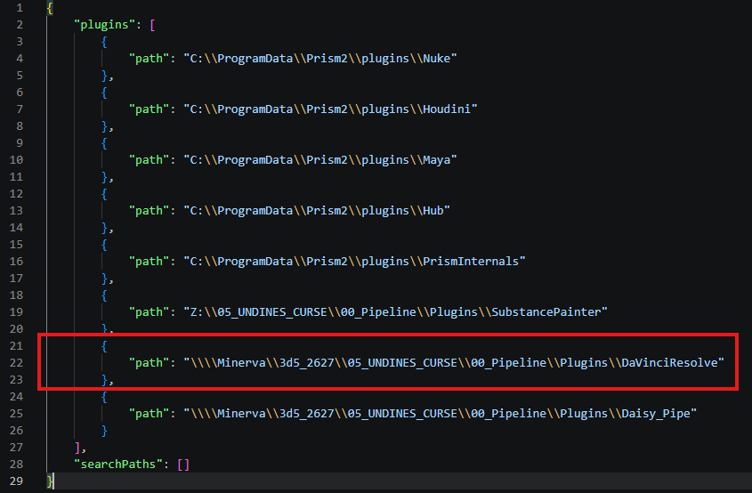

# Développement
[< Page précédente](../davinciresolve.md)

## Installation

Avant d'ajouter correctement le plugin, assurez-vous d'avoir installé préalable Prism2 (ou Prism) ainsi que DaVinci Resolve 21.0. Retrouvez ci-dessous le processus d'installation.

Tout d'abord, copiez le dossier de plugin DaVinciResolve dans votre **ProjetPrism/00_Pipeline/Plugins**
   
   

Dans le dossier de plugin DaVinciResolve/Integration:

- Copiez le fichier **Prism.py** et collez-le dans **C:\ProgramData\Blackmagic Design\DaVinci Resolve\Fusion\Scripts\Utility**
   

- Pour les élèves de la promo 2026/27 de l'ESMA de Montpellier, le dossier de plugin est déjà prsents dans vos pipe respectifs et comportent un fichier README qui comporte la marche à suivre d'installation ainsi que la ligne de code déjà adaptée à votre projet qu'il suffit de copier coller. Si vous avez une quelconque difficulté, allez voir Leeloo.
- Ajoutez la ligne ci-dessous au fichier **PluginPaths.json** déjà existant à cet emplacement **C:\Users\3D5\Documents\Prism2**

  > **{"path": "\\\\CheminAuProjetPrism\\00_Pipeline\\Plugins\\DaVinciResolve"}**
  >> Adaptez le début du chemin à l'emplacement local de votre projet/plugin
  Exemple pour un projet se nommant *05_UNDINES_CURSE*:
  

   
   

> Pour les élèves de la promo 2026/27 de l'ESMA de Montpellier, le dossier de plugin est déjà présent dans vos pipelines respectives et comportent un fichier **README** qui comporte la marche à suivre d'installation ainsi que la ligne de code déjà adaptée à votre projet qu'il suffit de copier coller. Si vous avez une quelconque difficulté, allez voir Leeloo.

***

[< Page précédente](../davinciresolve.md)
[Page suivante >](utilisation.md) 
*Daisy Pipeline 2025 - by Noa Escourbanies, Leeloo Trinh-Thieu and Thomas Rubio*