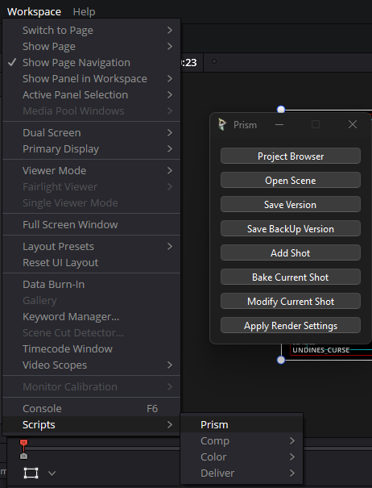
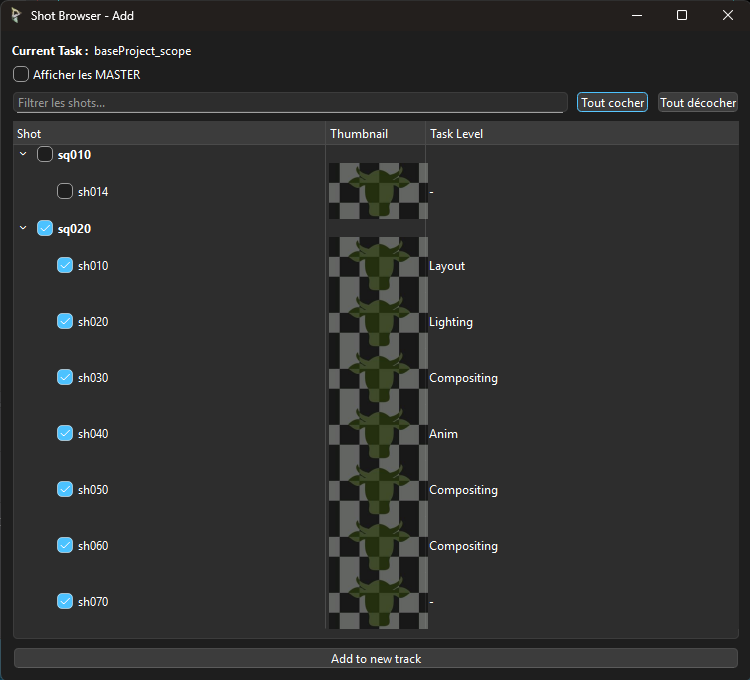
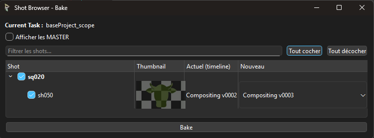
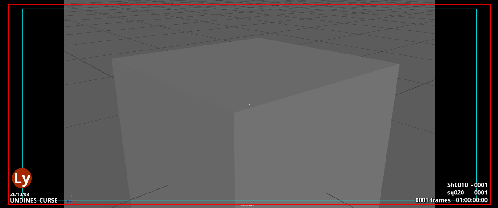
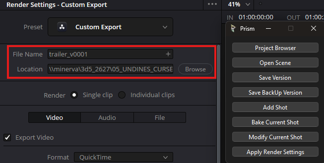

# Utilisation
[< Page précédente](development.md)

L'utilisation de ce plugin est centralisée sur DaVinci Resolve. Aucune scène de montage n'est ouvrable depuis Prism même et le Project Browser de Prism n'est pas utilisé.

# Sommaire
- [Utilisation](#utilisation)
- [Sommaire](#sommaire)
  - [Générale](#générale)
  - [ProjectBrowser](#projectbrowser)
  - [Scenefile](#scenefile)
    - [Open Scene](#open-scene)
    - [Save Version](#save-version)
    - [Save BackUp Version](#save-backup-version)
  - [Shots](#shots)
    - [Add Shot](#add-shot)
    - [Bake Current Shot](#bake-current-shot)
    - [Modify Current Shot](#modify-current-shot)
    - [Template](#template)
  - [Export](#export)

## Générale
Dans DaVinci Resolve vous pouvez accéder au plugin en allant dans "**Workspace/Scripts/Prism**". Une fenêtre s'ouvrira avec différentes options.

| Nom de l'option | Fonction simplifiée du bouton |
|:-------- |:--------:|
| [**Project Browser**](#projectbrowser)    | Ouvrir une instance du project browser de Prism dans DaVinci Resolve   |
| [**Open Scene**](#open-scene)    | Ouvre une fenêtre de choix du fichier du projet qui permet d'importer le fichier de montage pour travailler   |
| [**Save Version**](#save-version)    | Exporte le projet et écrase l'ancien export master   |
| [**Save BackUp Version**](#save-backup-version)    | Exporte le projet en backup SANS écraser le master   |
| [**Add Shot**](#add-shot)   | Ouvre un Shot Browser pour rechercher parmis les shots du projet pour en ajouter   |
| [**Bake Current Shot**](#bake-current-shot)    | Cherche dans le pipe si les shots actuellement dans la timeline ont une version plus récente et propose de les remplacer  |
| [**Modify Current Shot**](#modify-current-shot)    | Ouvre un Shot Browser pour rechercher parmis les shots, actuellement dans la timeline, toutes les versions à différents stades pour les remplacer   |
| [**Apply Render Settings**](#export)    | Rempli automatiquement le file name et la location de l'export dans le pipe   |

 

## ProjectBrowser
Toute la section 04_Editing de notre pipe se trouve en dehors du dossier 03_Production dans notre pipeline. Le montage est donc géré en dehors de Prism pour l'ouverture des projet de montage notamment.

Merci donc de ne pas essayer d'ouvrir votre montage depuis Prism.

De plus, ce plugin vous permettant directement d'ajouter des shots et stockant des informations sur ces shots, **merci de ne pas non plus drag and drop directement des shots depuis le project browser vers votre timeline**.

Ce Project Browser vous permet cependant de checker si vous êtes bien sur le bon projet.

## Scenefile
La gestion d'ouverture de projet de montage se gère directement depuis les boutons de la fenêtre du plugin.

Comme DaVinci stock les informations de votre avancée en montage en local sur votre PC et que nos projet se font en équipe sur un réseau, nous allons fonctionner en export et import de projet.

**Le projet ne peut donc être travaillé car par une seule personne à la fois**, sans quoi il y aura des problèmes d'override, mais à chaque fin de session de travail, il suffit de l'exporter et le prochain peut travailler dessus depuis n'importe quel PC.

Ici sont regroupés les boutons concernant la gestion des projet de montage.

### Open Scene
Ce bouton permet d'ouvrir un explorateur de fichier du projet qui permet d'importer le fichier de montage pour travailler.

Si un autre projet de même nom existe sur le PC *(exemple: vous avez travaillez sur ce projet mais votre collègue l'a amélioré entre-temps)*, ce script supprimera l'ancien projet et le remplacera par la version à jour.

### Save Version
Ce bouton permet d'**exporter le projet sur lequel vous avez travaillé et écrase l'ancien export master**.

Cette action est à faire **à chaque fois que vous finissez votre session de travail** pour que la prochaine personne qui travaillera sur votre projet ai la version à jour.

### Save BackUp Version
Ce bouton permet d'exporter le projet sur lequel vous avez travaillé en back up au cas où vous voudriez pouvoir revenir à cette étape plus tard.

Cette action est à faire à chaque fois que vous souhaitez garder en mémoire une version de votre montage.
A noter: **Cette action ne met pas à jour le master de montage**, il ne faut donc pas oublier de **Save Version** à la fin de votre session de travail.

## Shots
La gestion des shots et de leur mise à jour simpifiée se fait à travrs le Shot Browser.
Il référencie les shots à leur différents niveau d'avancement dans le pipe et permet de les importer ou mettre à jour ainsi que mettre à jour les infos visuelles ajoutées sur l'écran.

### Add Shot
Ce bouton permet d'ajouter des shots dans leur dernière version la plus avancée trouvée. Le shot est ajouté au niveau du curseur rouge, dans une nouvelle timeline pour éviter d'écraser les shots déjà présents.

### Bake Current Shot
Ce bouton permet de checker dans le pipe les shots qui ne sont plus à jour et propose de les remplacer par une version plus récente au choix.

### Modify Current Shot
Ce bouton permet d'ouvrir le Shot Browser avec tous les shots affichés et toutes leur versions au choix pour charger le niveau d'avancement spécifiquement voulu.

### Template
Grâce au Shot Browser, des informations sont visibles à l'écran.

A gauche on retrouve:
-  Le **nom du projet** Prism
    > Dans le cas des projets pour la promo 2026-27 de l'ESMA de Montpellier, les indices "XX_", avec XX comme chiffre, sont retirés du nom du projet pour plus de lisibilité.
- Le rond avec le **niveau d'avancement** du shot visible
    | Abbréviation | Avancement dans le pipe | Couleur |
    |:-----------: |:-----------------------:|:-------:|
    | **Ly**       | Layout                  | Rouge   |
    | **A**        | Animation               | Jaune   |
    | **Lg**       | Lighting                | Vert    |
    | **C**        | Compositing             | Bleu    |
- La **date** du shot visible

A droite on retrouve:
- Le nom du shot et de la séquence ainsi que leur comptage en frame
- Le comptage des shots au complet du film en frame et en secondes

Ces information visuelles ne sont pas dynamique mais se mettent à jour sur les shots en fonction de la timeline. Pour les mettre à jours, il suffit de cliquer **Valider dans le Shot Browser** (peu importe qu'il soit en mode Add, Bake ou Modify).

## Export
Le bouton **Apply Export Settings** permet de remplir automatiquement le filename et la location de l'export qui va être fait. Tout autre paramètre d'export reste libre pour plus d'adaptabilité aux projets.

***
[< Page précédente](development.md)
[Page suivante >](..\README.md) 
*Daisy Pipeline 2025 - by Noa Escourbanies, Leeloo Trinh-Thieu and Thomas Rubio*