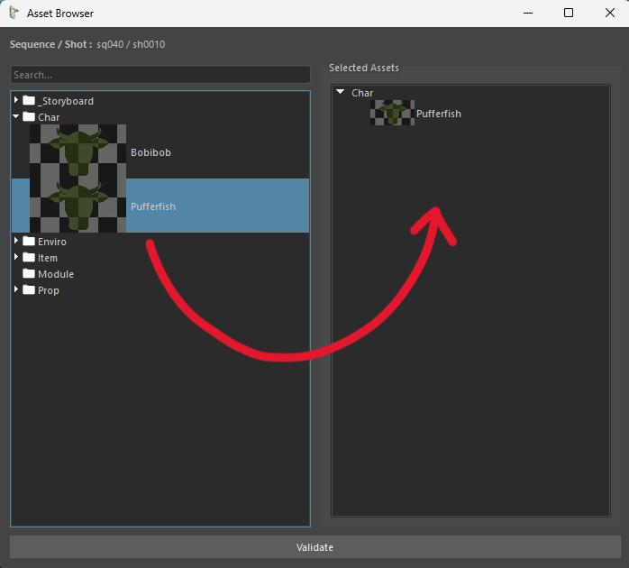
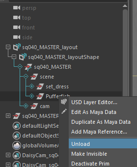
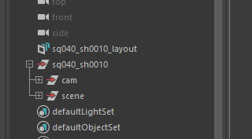
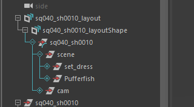
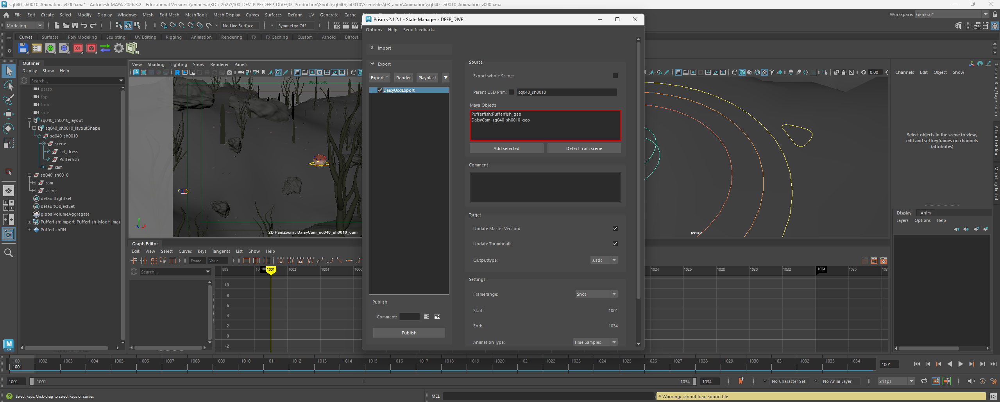
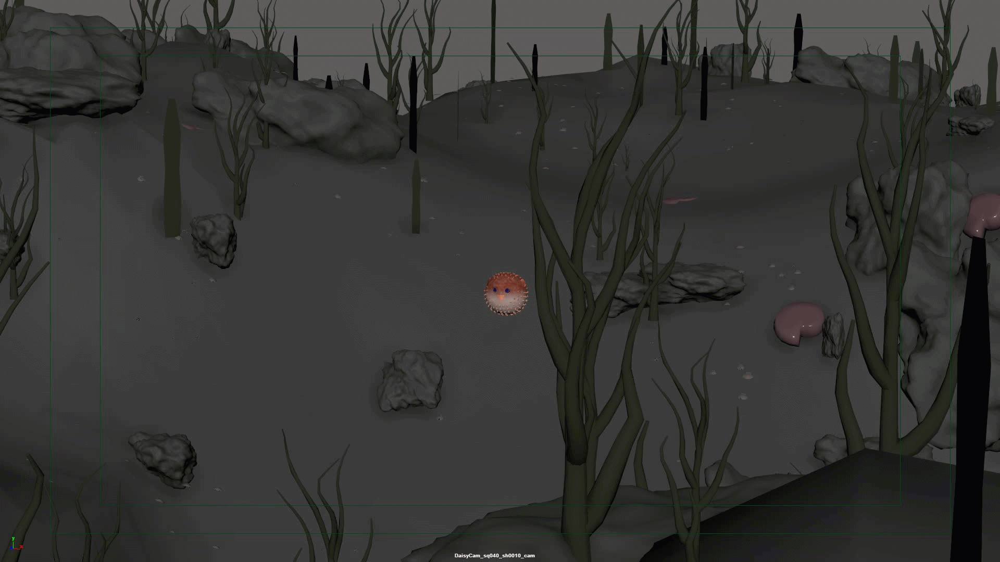

# Animation
Passons maintenant à l'animation. Si vous vous êtes personnellement occupé du RLO, cette partie devrait vous dire quelque-chose. On va voir comment importer votre layout sur Maya puis comment exporter votre animation. Sommaire *"clap clap :clap:"* !

Sommaire

- [Import](#import)
- [Export](#export)

***

## Import
En premier lieu, si ce n'est pas déjà fait, créez un département et une task "Animation", puis créez une scène Maya.

Avant toute animation, il faut importer des éléments à animer, mais aussi un décor. Alors importons le layout ! 
Mais comment faire ?

Ouvrez la **shelf Prism** et clickez sur le bouton "**Daisy import**" . Une fenêtre va s'ouvrir, si vous ne la connaissez pas, voici l'**Asset Browser**. Il va vous permettre d'importer les éléments que vous voulez. 
Faites un **drag and drop** de la colonne de gauche à la colonne de droite pour les assets présents dans votre scène, puis clickez sur "**Validate**".

!!! note
    N'importez pas les éléments présents dans votre set dress, il est déjà importé automatiquement. **Vous n'avez qu'à sélectionner vos chara et vos props** puisque dans la task "Animation", l'asset browser n'import que des rigs.

Vous pouvez voir que vos rigs ont étés importés au centre du monde. Vous pouvez aussi remarquer que ce que vous avez animé dans le RLO est présent comme un ghost pour vous aider à placer vos animations.

Mais si vous n'en voulez pas, vous pouvez aller chercher ces éléments dans l'**Outliner**, faire un **click droit** dessus et choisir "**Unload**". Faites bien attention d'unload l'asset USD et pas le rig.

!!! bug "Bug Maya"
    Il est possible que vous ne puissiez pas voir la hiérarchie de vos primitives et donc ne pas sélectionner en détail ce que vous voulez cacher. C'est un bug de Maya. 
    Pour le régler, allez dans le menu "**Display**" de l'Outliner, puis affichez les "**Shapes**" (vous pourrez les cacher à nouveau après).
    
    |Avant|Après
    |:|:
     | 

**Maintenant vous pouvez animer**. Vous pouvez retoucher à la caméra et aux rigs que vous venez d'importer.

Si vous voulez faire un playblast, vous pouvez aller dans la shelf Prism et clicker sur le bouton de playblast
 
et en remplissant les paramètres dans la popup qui s'ouvre.

***

## Export
Maintenant que nous avons notre animation, il est temps de l'exporter. Pour le faire, commencez par ouvrir le "**State Manager**" (l'icone avec les 2 flèches dans la shelf Prism). Ensuite clickez sur le bouton **"Export", puis "DaisysdExport"**. Finalement, clickez sur "**Detect from scene**" pour ajouter ce qu'il faut à l'export (tout est set automatiquement). 
Enfin, clickez sur "Publish", si vous ne le voyez pas, faites un **click droit sur DaisyUsdExport** puis "**Execute**".

Et voilà le playblast que j'ai fait tout à l'heure :

