# Layout
Il est maintenant temps de passer au Layout. Ici vous allez placer vos personnages et caméras d'abbord dans une scène commune à toute la séquence puis dans une scène par shot. Vous vous dites peut-être que c'est bizarre ce que je raconte et que je deviens sénil de manière un peu précoce mais laissez-moi vous expliquer plus en détail.

Un layout se découpe en 3 parties :

|Nom|Nom complet|Description
|---:|:---|:---
|RLO|Rough LayOut|Ici vous placez vos caméras et personnages pour l'ensemble des shots de la séquence, pas la peine de trop rentrer dans le détail, de faire des animations et des poses chiadées, ici on reste rough (tout ça sera retravaillé en animation)
|FLO|Final LayOut|C'est le même principe que le RLO mais spécifique à chaque shot, dans Daisy Pipe il sert surtout à optimiser la scène
|TLO|Technical LayOut|C'est ici que l'on définit les paramètres de rendu, au sein de Daisy Pipe nous avons décidé de le fusionner avec le Lighting par soucis d'optimisation

!!! warning "Attention"
    Ce département va définir l'ordre des shots ainsi que leur framerange. Attendez d'être au clair avant de passer du RLO au FLO, après avoir commencé à travailler les shots. Il devient difficile de tout modifier (même si ça reste toujours possible).

Maintenant que tout cela est précisé, il est temps de vous dire que cette page vas être plutôt longue, mais tenez bon, ça va bien se passer. Pour vous aider à y voir plus clair, voici un petit sommaire :

Sommaire

- [RLO](#rlo)
    - [Création des shots dans Houdini](#1-creation-des-shots-dans-houdini)
    - [Animation dans Maya](#2-animation-dans-maya)
    - [Import de l'animation dans Houdini again](#3-import-de-lanimation-dans-houdini-again)
- [FLO](#flo)
    - [Camera frustrum](#camera-frustrum)
    - [Load les payloads à la main](#load-les-payloads-a-la-main)
    - [save les payloads dans l'USD](#save-les-payloads-dans-lusd)

***

## RLO
Commençons par le RLO. On va travailler dans la task "Layout" de votre séquence, donc le shot nommé "MASTER". Ici, on va ajouter tous les éléments présents dans la séquence : le set dress, les personnages, les props et les caméras. Ces éléments seront animés pour beaucoup.

Alors préparez-vous ! On va faire quelques allés et retours entre Maya et Houdini.

### 1 Création des shots dans Houdini
Commençons par Houdini ! Ne vous en faites pas si vous ne connaissez pas le logiciel, on va y aller étape par étape.

#### Création du template

Tout d'abbord il faut créer une nouvelle scène Houdini dans la task "Layout". Pour cela, vous connaissez, faites un click droit dans la partie "Files" de Prism, allez dans "Create new version from preset" et choisissez "EmptyScene Houdini". Ensuite ouvrez la scène.

!!! danger "Attention"
    Pensez bien à être dans le shot nommé "MASTER" sinon le template créé ne sera pas le bon (et ne pourras même pas se créer).

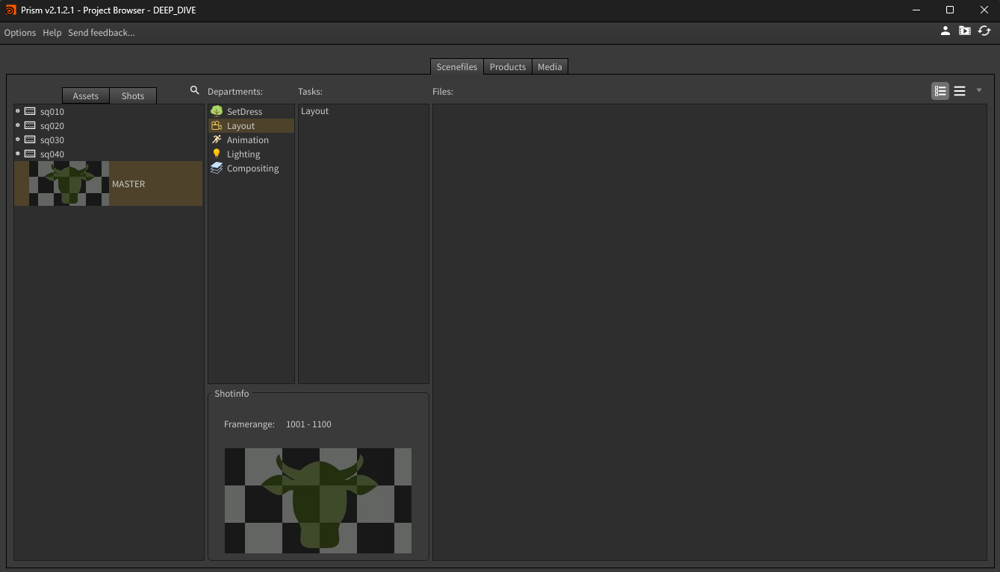

Maintenant que vous avez ouvert votre scène Houdini, il va vous falloir créer le template. Une fois n'est pas coutume, vous pouvez créer le node "Daisy Create Template" et clicker sur le bouton "Create template". 
La fenêtre "**Asset Browser**" s'ouvre, elle vous sert à sélectionner les éléments que vous voulez ajouter à votre set dress. Pour les sélectionner, faites un **drag and drop** des assets que vous voulez de la colonne de gauche vers la colonne de droite. Une fois que vous êtes satisfait de votre sélection, clickez sur "**Validate**" pour créer le template.

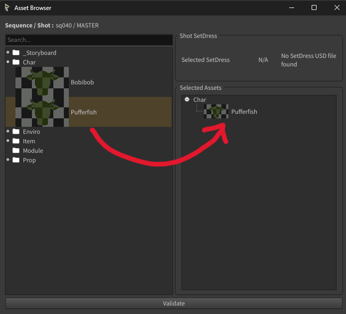

Une fois que vous avez validé, votre template se créé.

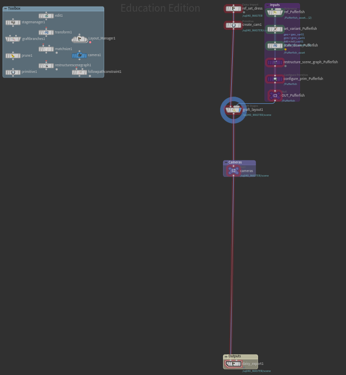

#### Utilisation du template

Voilà à quoi ressemble le template, le votre peut être différent dans la partie "Inputs" à droite. On va passer en revue son utilisation mais sachez que si vous voulez plus d'informations dessus, vous pourrez retrouver tout le détail de son fonctionnement dans [la page dédiée aux templates](../houdini/templates.md#template-de-layout-master).

Il est important de noter que certains nodes sont de la même couleur que leur backdrop, ça veut dire que vous n'avez pas besoin d'y toucher à moins de savoir parfaitement ce que vous faites. Maintenant, à quoi ressemble le template ?

1. **Le backdrop "Inputs"** vous retrouverez tous les nodes relatifs à l'import et au placement de chaque asset, sa taille dépendra du nombre d'asset que vous importerez.
    - reference : permet d'importer l'asset en référence
    - set variant : si vous avez plusieurs variants de geo ou de groom, vous pouvez choisir ici sur lequel travailler
    - scale down : permet d'abaisser la taille de l'asset s'il vient de Maya
4. **Le backdrop "Cameras"** sert à ranger toutes les caméras de la scène (on y reviendra)
3. **Le backdrop "Outputs"** qui sert à exporter votre set dress en USD
    - daisy export : permet d'exporter le set dress en usd
4. **Le backdrop "Toolbox"** répertorie des nodes qui pourraient vous être utils.

#### Le node Layout Manager

Vous trouvez qu'il y a trop de nodes ? Tant-pis, on va en rajouter ! 
Maintenant, il est temps de sortir un nouveau node : le "[Daisy Layout Manager](../houdini/hda.md#daisy-layout-manager)". **Connectez-le au node appelé "cameras"** comme ceci :

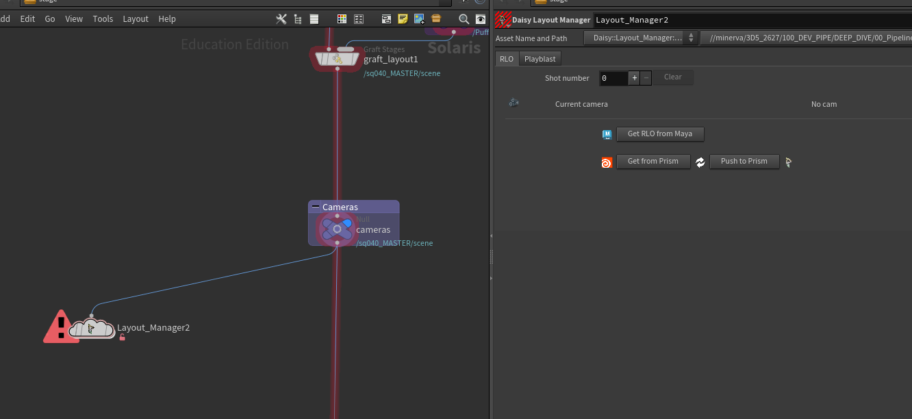

Vous pouvez voir sur l'image du dessus qu'il y a plusieurs paramètres. Celui qui nous intéresse, c'est le premier : "**Shot number**", clickez sur le "**+**" pour ajouter un nouveau shot. Vous pourrez voir qu'une nouvelle caméra a été créée.

!!! warning "Attention"
    Je vais vous demander de ne pas changer son nom ni de la supprimer à la main. Les caméras sont automatiquement bien nommées, bien placées dans la hiérarchie et ont certains paramètres correctement remplis. Pour faire certaines actions dans ce genre, je vous expliquerai comment faire en dessous.

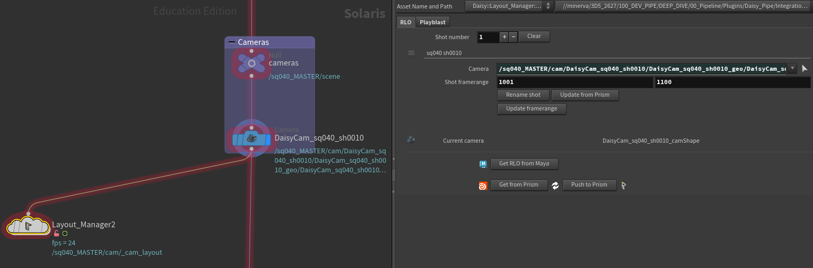

!!! tip
    1. Si vous voulez **supprimer un shot** (et donc une caméra), allez dans le layout manager, faites un **click droit** sur les trois barres en haut à gauche du shot (à côté du nom) et faites "**Delete Selected Instances**", vous pouvez aussi appuyer sur la touche "**suppr**". 
    Vous pouvez aussi clicker sur le "**-**" pour supprimer le dernier shot.

    2. Si vous voulez **renommer le shot**, clickez sur le bouton "**Rename shot**" et choisissez le numéro de shot que vous voulez.

    3. Si vous voulez **supprimer tous les shots** d'un coup, clickez sur le bouton "**Clear**".

Automatiquement, la caméra est sélectionnée, si vous le souhaitez vous pouvez placer la caméra et même commencer à l'animer **mais ce n'est pas obligatoir**. Ensuite ajoutez autant de caméras que vous voulez, rappelez-vous : une caméra est égale à un shot.

Vous pouvez aussi commencer à animer la position de vos persos et props pour vous aider à placer les caméras.

Une fois que vous avez toutes vos caméras, il est temps de set leur framerange. Choisissez la frame de début et de fin de chacun des shots en faisant attention de ne pas les superposer. Par exemple : 

- **shot 1** : 1001 - 1034
- **shot 2** : 1035 - 1089
- **shot 3** : 1090 - 1156

À partir de ce moment là, il est possible de voir vos changements de cam en affichant le layout manager et en prenant la vue de la cam "**_cam_layout**". Ensuite, quand vous lirez l'animation, vous switcherez automatiquement d'une cam à l'autre.

Maintenantque que le framerange est set, le plus important est fait, il faut juste **clicker une fois sur le bouton "Update Framerange"** de chaque shot dans le Layout Manager. Vous pouvez à présent exporter votre RLO avec le node "**Daisy Export**". 
Voilà à quoi ressemble mon RLO à la sortie d'Houdini.

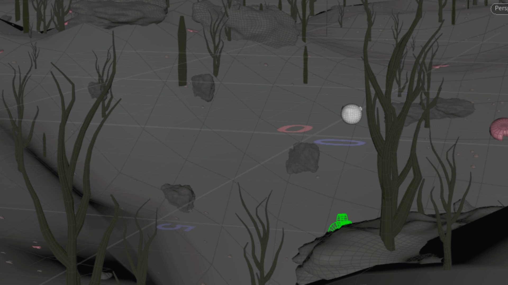

??? info "Pour les Dev"
    Nous faisons une conversion de framerange entre le MASTER et les shots. Par exemple, un shot qui, dans le MASTER aura un framerange de 1205 - 1274, sera convertit dans son shot en 1001 - 1070. 
    Pourquoi faire ça ? Pour que tous les shots puissent commencer à la frame 1001 et donc faciliter le travail de tout le monde par la suite.

    Il est important de noter que cette conversion de framerange est stockée dans le fichier "framerange.json" dans le pipe. Ce fichier est modifié à chaque création, suppression ou rennomage de shot grâce au Layout Manager, mais aussi quand on click sur le bouton "update framerange". Voilà pourquoi il ne faut pas supprimer à la main les caméras, ça crée une désyncronisation entre la scène et le fichier framerange.json.

### 2 Animation dans Maya
Très bien, maintenant que notre RLO est exporté, on va pouvoir passer dans Maya pour utiliser vos rigs low et ajuster les caméras.

Alors allons-y, ouvrons Maya. Une fois complètement ouvert, créez une scène dans **la task Animation du shot MASTER** via Prism. Une fois cette scène ouverte, il va falloir importer le RLO qu'on a sorti d'Houdini. Pour ceci, allez dans **la shelf Prism** et clickez sur le bouton "Daisy import"
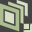.
Un Asset Browser s'ouvre, comme pour Houdini faites un drag and drop des assets que vous voulez animer (les mêmes que pour Houdini) et clickez sur "Validate".

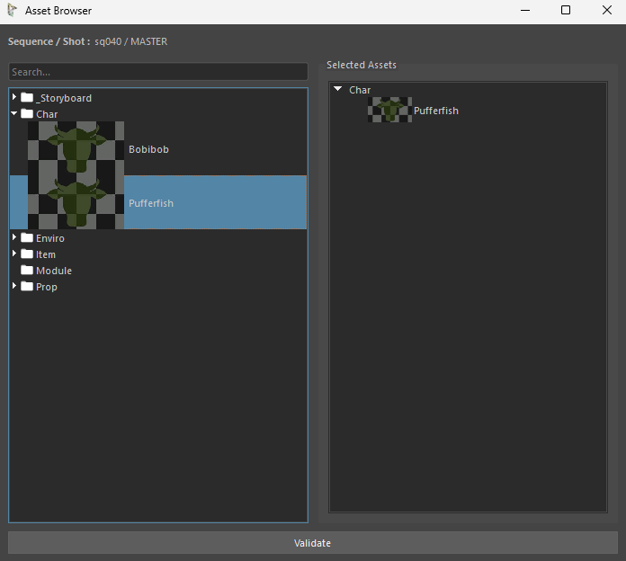

Voilà, vous pouvez maintenant travailler sur votre RLO dans Maya. Nous vous avons importé automatiquement les Rigs Low de chaque asset et les caméras auxquelles nous avons ajouté un rig et transféré les keyframes. Il est possible que vous vous posiez quelques questions sur ce que vous voyez, ne vous en faites pas, je vait tout vous expliquer.

!!! tip "Écran rose"
    Après cet import, vous allez probablement vous retrouver avec un **écran rose**. C'est normal, nous vous avons fait un rig de caméra automatique, et cet écran rose représente un plane pour set le focus de chaque caméra.

    Si vous voulez le désactiver, allez dans la channel box la caméra et **désactivez "Depth Of Field"**. Ou alors, si vous voulez garder le depth of field sans avoir le plane d'affiché, allez dans le menu "Show" du viewport, puis "Viewport" et **désactivez "NURBS Surfaces"**.

!!! tip "Camera Sequencer"
    Vous avez la possibilité de voir vos changements de caméra se faire automatiquement. Pour faire ça, il faut ouvrir la fenêtre "**Camera Sequencer**" qui fonctionne plus ou moins comme un logiciel de montage. Si vous avez bien fait toutes les manip dans Houdini, tout devrait être géré automatiquement.

    Maintenant si vous faites "**Play**" depuis le Camera Sequencer, les caméras changent automatiquement.

    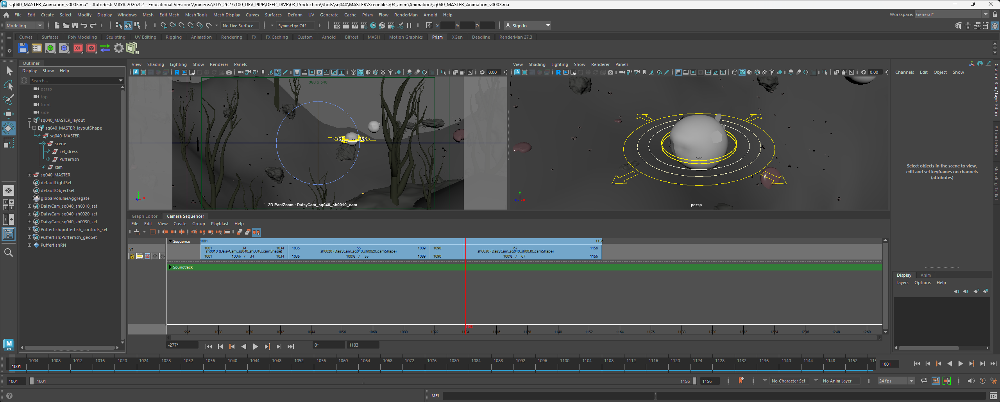

    !!! warning
        Si vous ne faites pas Play depuis le Camera Sequencer, vous resterez sur la cam active jusqu'à ce que vous arrêtiez la lecture, puis la caméra se remettra à jour. Bref, ça fera des trucs bizarres et pas pratiques.

!!! info "Ghost"
    Vous remarquerez peut-être que les assets que vous avez importé sont présents deux fois dans la scène. C'est totalement normale, il y a **le Rig Low** que vous avez importé précédemment mais il y a aussi **les éléments que vous avez créé dans Houdini**. Vous pouvez vous en servir comme d'un ghost pour vous aider à replacer vos rigs.

    Mais si vous n'en voulez pas, vous pouvez aller chercher ces éléments dans l'**Outliner**, faire un **click droit** dessus et choisir "**Unload**". Faites bien attention d'unload l'asset USD et pas le rig.

    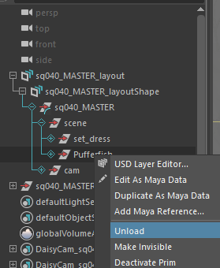

Dans notre exemple, j'ai modifié l'animation de notre poisson et j'ai animé la première caméra (qui était statique auparavant).

Quand vous avez terminé votre animation, vous pouvez l'exporter en USD. Pour le faire, commencez par ouvrir le "**State Manager**" (l'icone avec les 2 flèches dans la shelf Prism). Ensuite clickez sur le bouton **"Export", puis "DaisysdExport"**. Finalement, clickez sur "**Detect from scene**" pour ajouter ce qu'il faut à l'export (tout est set automatiquement). 
Enfin, clickez sur "Publish", si vous ne le voyez pas, faites un **click droit sur DaisyUsdExport** puis "**Execute**".

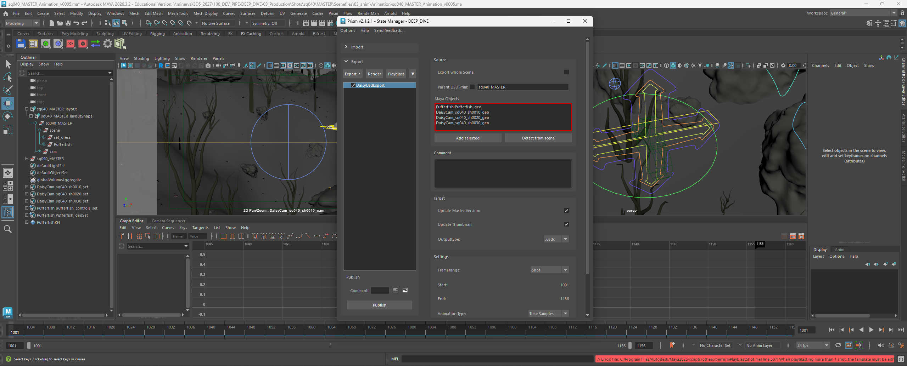

Voilà, maintenant que vous avez votre animation, il est temps de la merge avec notre scène dans Houdini.

Courage, vous y êtes presque ! :muscle:

### 3 Import de l'animation dans Houdini again

Allez, plus qu'une étape ! Ne vous inquiétez pas, c'est loin d'être la plus longue.

Alors retournons sur notre scène Houdini. On va essayer d'appliquer l'animation sur les assets de votre scène. 
Sélectionnez le Layout Manager et clickez sur le bouton "**Get RLO from Maya**" en bas.

Cette action va vous créer un nouveau node Daisy Import qui va importer votre animation et la placer correctement avec les bons paramètres pour merge votre animation.

**Félicitation, vous avez terminé votre RLO !** :tada: :partying_face:

Finalement, vous pouvez exporter un playblast de ce RLO depuis Houdini (flipbook). Pour faire ça, pas de panique, allez dans le **Layout Manager**, dans l'onglet "**Playblast**" et clickez sur le bouton "**Render playblast**".

!!! info "Création des shots"
    **Une fois que votre RLO sera terminé et validé**, il vous faudra créer les shots à partir de ce dernier. Mais c'est un travail long, fastidieux et très répétitif ... 
    Vous me voyez venir n'est-ce pas ? On s'en occupe !

    Allez dans le **Layout Manager**, dasn l'onglet RLO et clickez sur le bouton "**Push to Prism**". Ce bouton créera automatiquement tous les shots que vous avez mis dans le Layout Manager, les renommera correctement et leur assignera le bon framerange.

    |Avant|Après
    |:|:
    |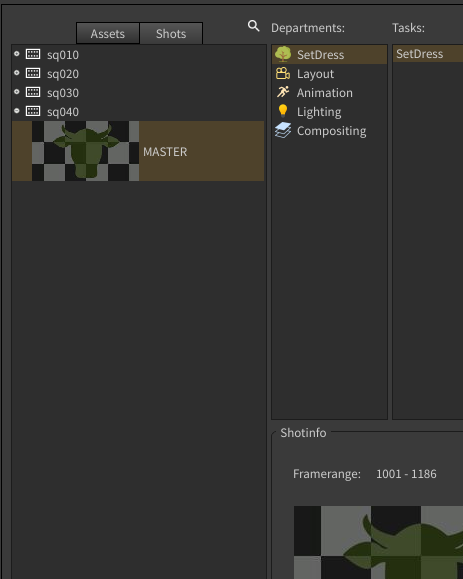|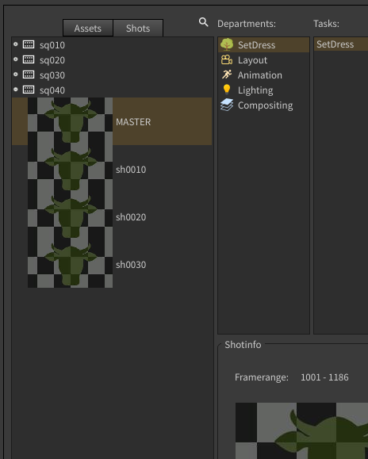

Maintenant vous avez l'habitude, il faut **exporter la scène avec Daisy Export** comme vous l'avez fait avant d'aller dans Maya.

***

## FLO

Le RLO c'était un gros morceau, maintenant on va passer au FLO qui est bien plus simple si vous avez bien fait votre travail avant. 
Qu'est-ce que j'entend par là ?

Et bien, le FLO c'est un layout qui est spécifique à chaque shot. Ici on va donc chercher à **corriger 2 ou 3 trucs sur le RLO** si l'on veut mais aussi et surtout, on va essayer d'**optimiser la scène** au maximum. Alors comment faire ça ? Dans cette doc je vais vous parler surtout d'une manière d'optimiser grâce aux [payloads](../../overview/usd.md#payload).

!!! warning "Attention"
    Avant de commencer, pensez bien à créer vos shots et à exporter votre RLO ([voir la fin de la partie ci-dessus](#3-import-de-lanimation-dans-houdini-again)).

Pour commencer, **créez une scène Houdini dans la task Layout d'un shot** (qui n'est pas le MASTER vous vous en doutez). Ouvrez cette scène Houdini puis **créez le template** avec le node [Daisy Create Template](../houdini/hda.md#create-template). Vous vous retrouvez avec ce genre de scène.

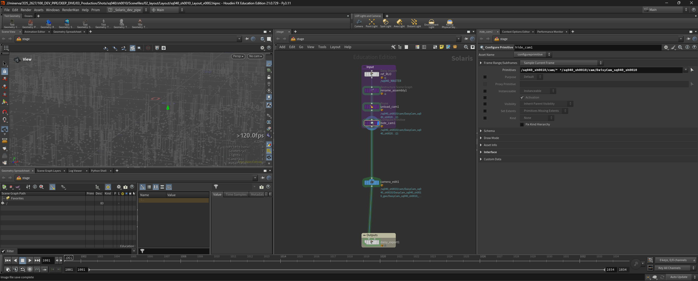

Là vous vous demandez peut-être, submergé par la panique : "Mais qu'est-ce qu'ils ont fait à ma scène !!!". **Tout est normal**. 
Les carrés gris sont les bounding box de vos assets. Pourquoi ils s'affichent comme ça ? Tout simplement parce que **nous avons désactivé tous les payloads de la scène**. Votre mission maintenant, ça va être de les réactiver, mais seulement ceux qui sont utils.

Pour définir les éléments qui sont utils, demandez vous déjà si ils sont visibles dans le shot (ou si leur ombre est visible dans le shot). À partir de là vous allez pouvoir activer ou non vos payloads.

### Camera frustrum

Si vous ne voulez pas activer les payloads à la main, je vais vous présenter un petit node qui pourrait vous être utile : [Daisy Camera Frustrum](../houdini/hda.md#daisy-camera-frustrum). 
Ce node vous sert à load les payloads qui sont visibles à la caméra. Comment l'utiliser ?

Commencez par le connecter à la fin de votre scène (avant la partie Outputs). Pensez bien à **connecter les 2 entrées du node** (la 2nd correspond à la caméra). Ensuite, dans le paramètre **"Camera Path", ajoutez le path de la caméra** du shot. Finalement clickez sur le bouton "**Analyze camera anim**" puis "**Update**".

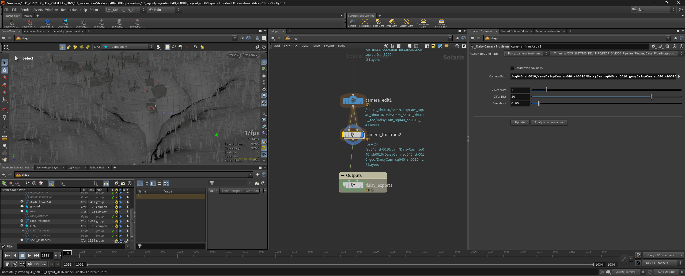

Comme vous pouvez le voir ci-dessus, les assets ne sont load que si ils sont dans le champ de la caméra.

!!! info
    Je dois vous avouer quelque-chose, j'ai triché pour faire l'image du dessus. En réalité, tous mes assets se load sur la scène. Mais pourquoi ?

    Il faut savoir que j'ai fait mon set dress avec des instanceurs (pour dupliquer mes assets sans utiliser trop de ressource). Or, **les instanceurs ne sont comptés que comme un élément**, donc quand on load un instanceur, on load tous les éléments qui sont contenus dedans. Donc ne soyez pas surpris si vous n'avez pas un joli cône d'éléments chargés. Dans mon cas toute la scène est load.
    
    Notez aussi que **le point de pivot des instanceurs se place au centre du monde**. Donc il ne sera pas load par le camera frustrum si vous ne voyez pas le centre du monde avec la cam.

### Load les payloads à la main

Il est possible que le camera frustrum ne load pas certains éléments mâma si on les voit à la caméra. Il est aussi possible que vous vouliez load des éléments qui ne sont pas directement visibles (pour faire des ombres par exemple). Dans ce cas, il faut que vous sachiez comment faire.

Pour ajouter des éléments à load à la main, il faut utiliser un node "**configurestage**". Vous pouvez le placer juste après le camera frustrum. **Passez le paramètre "Load Primitives" en "Add and remove primitives to load"**, puis placez le path des éléments à load dans "**Load paths from input**". Vous pouvez en ajouter autanat que vous voulez (et aussi en supprimer avec le paramètre "Remove load paths from input").

Pour ajouter tous ces éléments facilement, sélectionnez les soit dans le viewport (en restant appuyé sur la touche S) soit dans le scene graph tree, puis faitez un drag and drop dans le champ que vous voulez.

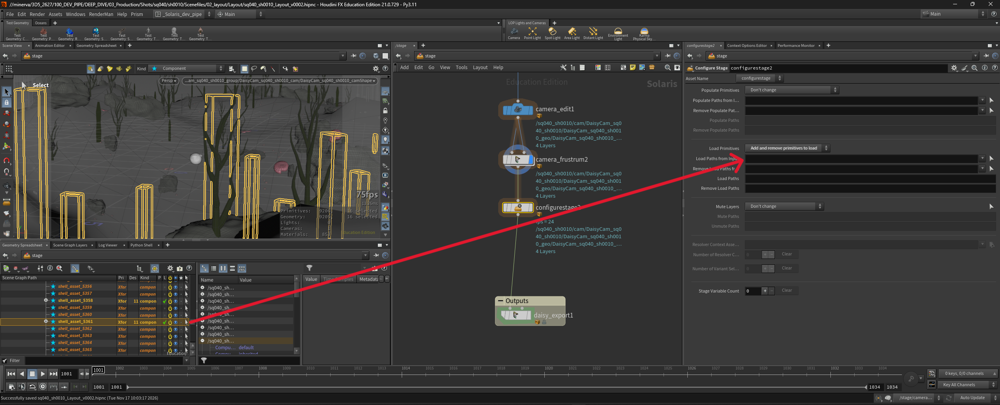

### Save les payloads dans l'USD

Dans peu de temps vous allez exporter votre fichier USD (comme à chaque fois), mais vous allez faire face à un petit problème : le loading des payloads ne se sauvegarde pas dans les fichiers USD.

Pour éviter que votre travail n'ait servi à rien, je vous ai fait là aussi un petit node : [Daisy Save Loaded Payloads](../houdini/hda.md#daisy-save-loaded-payloads). 
Ce node sert à **stocker la liste des payloads** que vous avez load dans une **collection** (un autre concept USD) et ainsi garder en mémoire votre travail tout au long de la production. Par chance, nous avons intégré ce node au Daisy Export (dans les advanced settings) donc **il s'activera automatiquement à l'export**. 
Maintenant, quand vous utiliserez un autre node : [Daisy Load Saved Payloads](../houdini/hda.md#daisy-load-saved-payloads), vous pourrez récupérer les payloads que vous avez sauvegardé.

Alors une fois que vous avez terminé toutes vos optimisations et modifications sur le shot, vous pouvez **exporter la scène avec le node Daisy Export**.