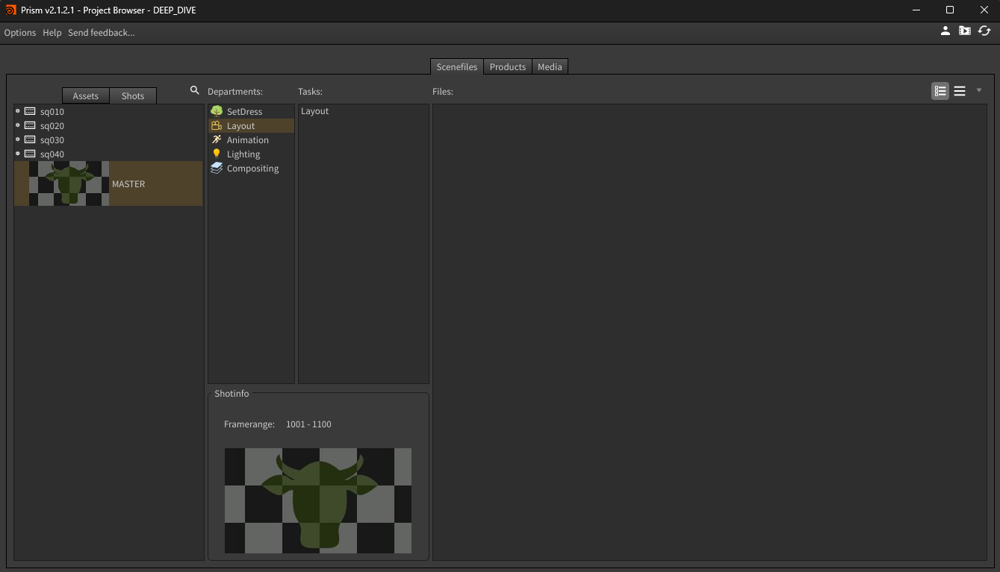
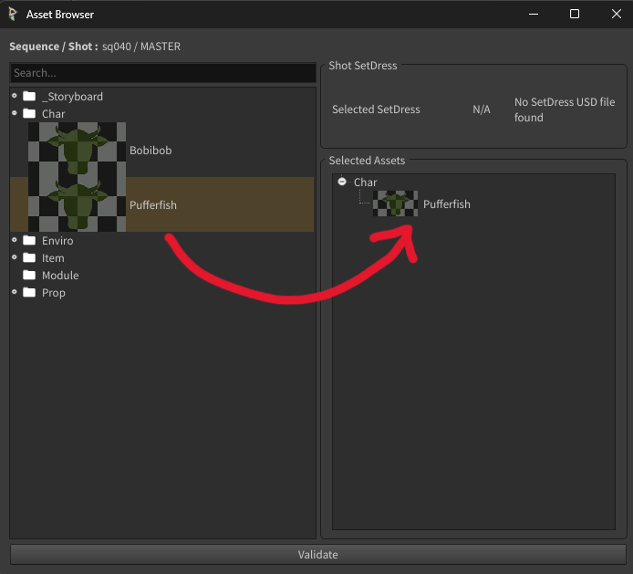
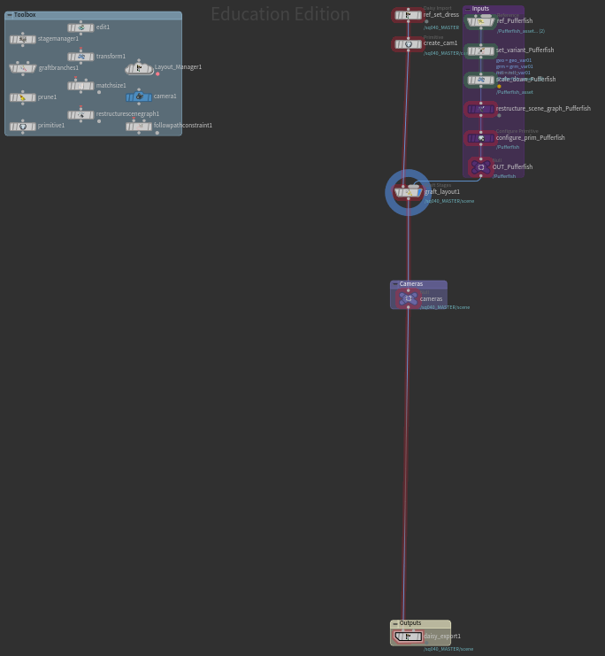
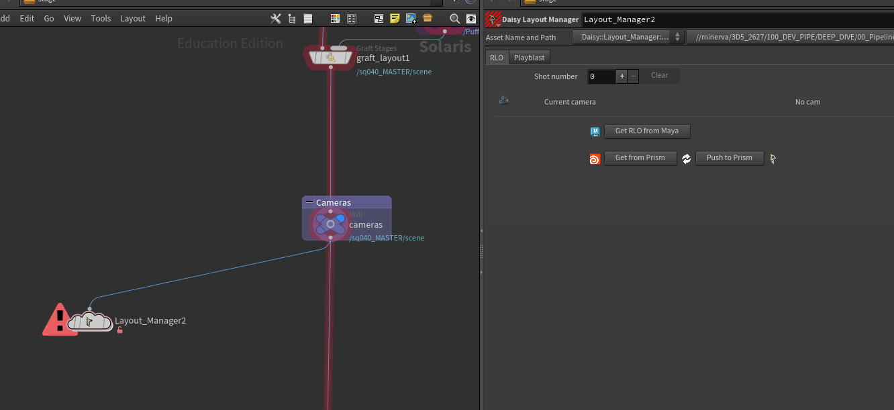
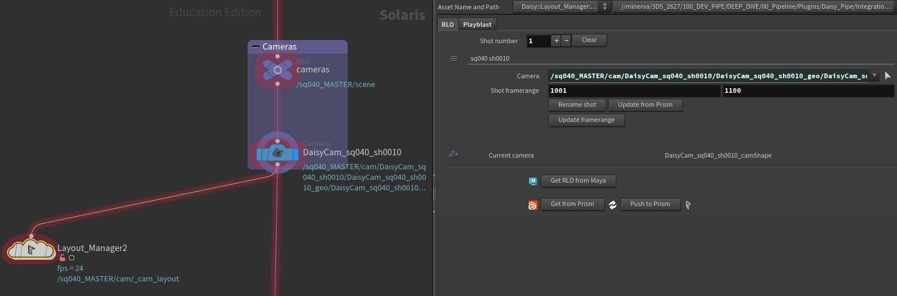
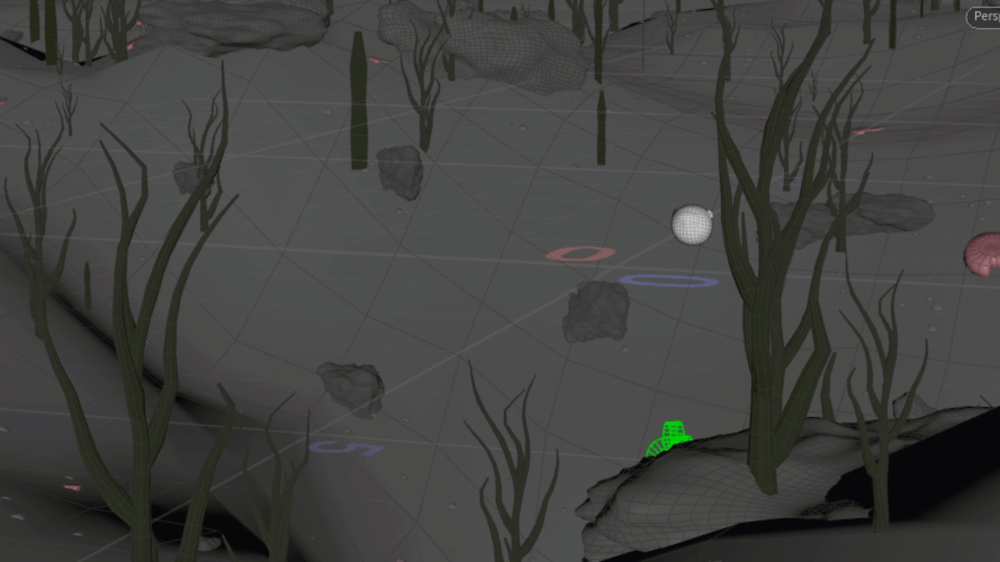

# Layout
Il est maintenant temps de passer au Layout. Ici vous allez placer vos personnages et caméras d'abbord dans une scène commune à toute la séquence puis dans une scène par shot. Vous vous dites peut-être que c'est bizarre ce que je raconte et que je deviens sénil de manière un peu précoce mais laissez-moi vous expliquer plus en détail.

Un layout se découpe en 3 parties :

|Nom|Nom complet|Description
|---:|:---|:---
|RLO|Rough LayOut|Ici vous placez vos caméras et personnages pour l'ensemble des shots de la séquence, pas la peine de trop rentrer dans le détail, de faire des animations et des poses chiadées, ici on reste rough (tout ça sera retravaillé en animation)
|FLO|Final LayOut|C'est le même principe que le RLO mais spécifique à chaque shot, dans Daisy Pipe il sert surtout à optimiser la scène
|TLO|Technical LayOut|C'est ici que l'on définit les paramètres de rendu, au sein de Daisy Pipe nous avons décidé de le fusionner avec le Lighting par soucis d'optimisation

!!! warning "Attention"
    Ce département va définir l'ordre des shots ainsi que leur framerange. Attendez d'être au clair avant de passer du RLO au FLO, après avoir commencé à travailler les shots. Il devient difficile de tout modifier (même si ça reste toujours possible).

Maintenant que tout cela est précisé, il est temps de vous dire que cette page vas être plutôt longue, mais tenez bon, ça va bien se passer. Pour vous aider à y voir plus clair, voici un petit sommaire :

Sommaire

- [RLO](#rlo)
    - [Création des shots dans Houdini](#1-creation-des-shots-dans-houdini)
    - [Animation dans Maya](#2-animation-dans-maya)
    - [Import de l'animation dans Houdini again](#3-import-de-lanimation-dans-houdini-again)
- [FLO](#flo)

***

## RLO
Commençons par le RLO. On va travailler dans la task "Layout" de votre séquence, donc le shot nommé "MASTER". Ici, on va ajouter tous les éléments présents dans la séquence : le set dress, les personnages, les props et les caméras. Ces éléments seront animés pour beaucoup.

Alors préparez-vous ! On va faire quelques allés et retours entre Maya et Houdini.

### 1 Création des shots dans Houdini
Commençons par Houdini ! Ne vous en faites pas si vous ne connaissez pas le logiciel, on va y aller étape par étape.

#### Création du template

Tout d'abbord il faut créer une nouvelle scène Houdini dans la task "Layout". Pour cela, vous connaissez, faites un click droit dans la partie "Files" de Prism, allez dans "Create new version from preset" et choisissez "EmptyScene Houdini". Ensuite ouvrez la scène.

!!! danger "Attention"
    Pensez bien à être dans le shot nommé "MASTER" sinon le template créé ne sera pas le bon (et ne pourras même pas se créer).

Maintenant que vous avez ouvert votre scène Houdini, il va vous falloir créer le template. Une fois n'est pas coutume, vous pouvez créer le node "Daisy Create Template" et clicker sur le bouton "Create template". 
La fenêtre "**Asset Browser**" s'ouvre, elle vous sert à sélectionner les éléments que vous voulez ajouter à votre set dress. Pour les sélectionner, faites un **drag and drop** des assets que vous voulez de la colonne de gauche vers la colonne de droite. Une fois que vous êtes satisfait de votre sélection, clickez sur "**Validate**" pour créer le template.

Une fois que vous avez validé, votre template se créé.

#### Utilisation du template

Voilà à quoi ressemble le template, le votre peut être différent dans la partie "Inputs" à droite. On va passer en revue son utilisation mais sachez que si vous voulez plus d'informations dessus, vous pourrez retrouver tout le détail de son fonctionnement dans [la page dédiée aux templates](../houdini/templates.md#template-de-layout-master).

Il est important de noter que certains nodes sont de la même couleur que leur backdrop, ça veut dire que vous n'avez pas besoin d'y toucher à moins de savoir parfaitement ce que vous faites. Maintenant, à quoi ressemble le template ?

1. **Le backdrop "Inputs"** vous retrouverez tous les nodes relatifs à l'import et au placement de chaque asset, sa taille dépendra du nombre d'asset que vous importerez.
    - reference : permet d'importer l'asset en référence
    - set variant : si vous avez plusieurs variants de geo ou de groom, vous pouvez choisir ici sur lequel travailler
    - scale down : permet d'abaisser la taille de l'asset s'il vient de Maya
4. **Le backdrop "Cameras"** sert à ranger toutes les caméras de la scène (on y reviendra)
3. **Le backdrop "Outputs"** qui sert à exporter votre set dress en USD
    - daisy export : permet d'exporter le set dress en usd
4. **Le backdrop "Toolbox"** répertorie des nodes qui pourraient vous être utils.

#### Le node Layout Manager

Vous trouvez qu'il y a trop de nodes ? Tant-pis, on va en rajouter ! 
Maintenant, il est temps de sortir un nouveau node : le "[Daisy Layout Manager](../houdini/hda.md#daisy-layout-manager)". **Connectez-le au node appelé "cameras"** comme ceci :

Vous pouvez voir sur l'image du dessus qu'il y a plusieurs paramètres. Celui qui nous intéresse, c'est le premier : "**Shot number**", clickez sur le "**+**" pour ajouter un nouveau shot. Vous pourrez voir qu'une nouvelle caméra a été créée.

!!! warning "Attention"
    Je vais vous demander de ne pas changer son nom ni de la supprimer à la main. Les caméras sont automatiquement bien nommées, bien placées dans la hiérarchie et ont certains paramètres correctement remplis. Pour faire certaines actions dans ce genre, je vous expliquerai comment faire en dessous.

!!! tip
    1. Si vous voulez **supprimer un shot** (et donc une caméra), allez dans le layout manager, faites un **click droit** sur les trois barres en haut à gauche du shot (à côté du nom) et faites "**Delete Selected Instances**", vous pouvez aussi appuyer sur la touche "**suppr**". 
    Vous pouvez aussi clicker sur le "**-**" pour supprimer le dernier shot.

    2. Si vous voulez **renommer le shot**, clickez sur le bouton "**Rename shot**" et choisissez le numéro de shot que vous voulez.

    3. Si vous voulez **supprimer tous les shots** d'un coup, clickez sur le bouton "**Clear**".

Automatiquement, la caméra est sélectionnée, si vous le souhaitez vous pouvez placer la caméra et même commencer à l'animer. Ensuite ajoutez autant de caméras que vous voulez, rappelez-vous : une caméra est égale à un shot.

Vous pouvez aussi commencer à animer la position de vos persos et props pour vous aider à placer les caméras.

Une fois que vous avez toutes vos caméras, il est temps de set leur framerange. Choisissez la frame de début et de fin de chacun des shots en faisant attention de ne pas les superposer. Par exemple : 

- **shot 1** : 1001 - 1034
- **shot 2** : 1035 - 1089
- **shot 3** : 1090 - 1156

À partir de ce moment là, il est possible de voir vos changements de cam en affichant le layout manager et en prenant la vue de la cam "**_cam_layout**". Ensuite, quand vous lirez l'animation, vous switcherez automatiquement d'une cam à l'autre.

Maintenantque que le framerange est set, le plus important est fait, vous pouvez à présent exporter votre RLO avec le node "**Daisy Export**". 
Voilà à quoi ressemble mon RLO à la sortie d'Houdini.

### 2 Animation dans Maya

### 3 Import de l'animation dans Houdini again

***

## FLO