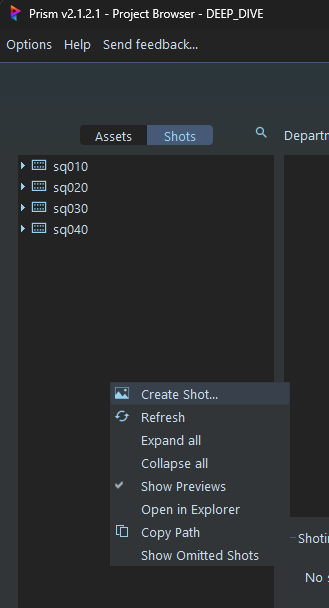
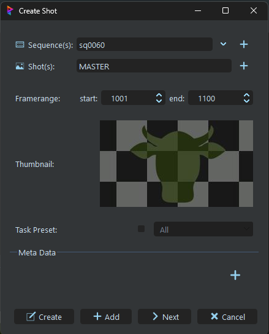
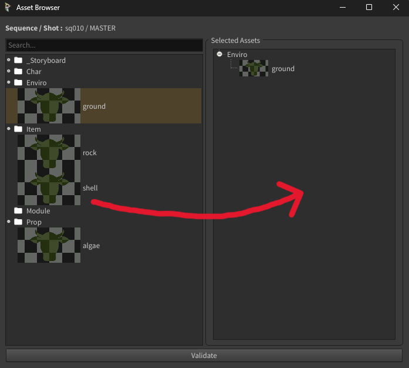
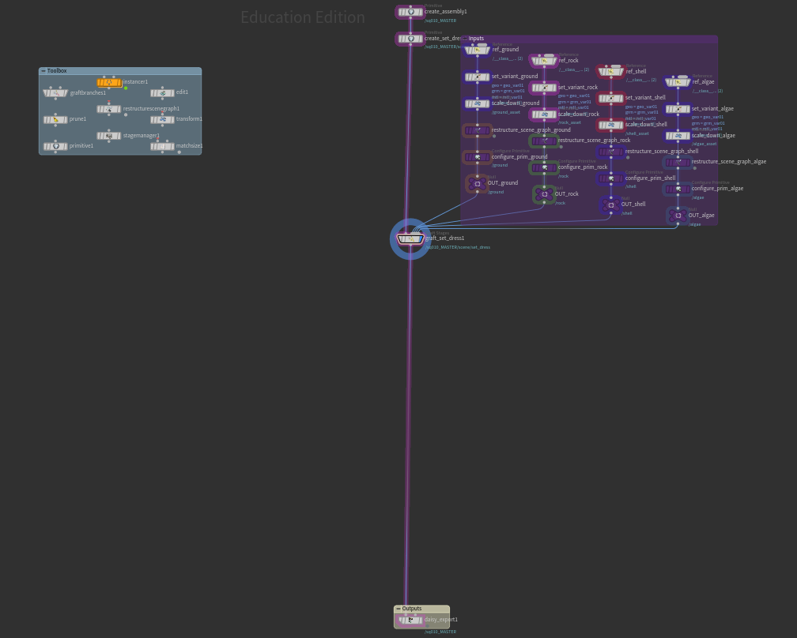
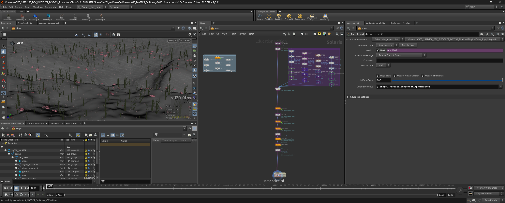

# Set Dress
[< page précédente](../departments.md) 
Maintenant que nos assets sont créés, il est temps de les mettre tous ensemble dans une scène. C'est tout l'intérêt du set dress. Dans ce département nous allons utiliser Houdini pour assembler le décor de notre séquence. Alors, comment faire ? Voici un petit sommaire ...

- [Création du template](#création-du-template)
- [Présentation du template](#présentation-du-template)
- [Utilisation du template](#utilisation-du-template)

> 
>Avant de commencer, assurez-vous bien d'avoir fait au moins un create USD asset pour chaque asset que vous voulez importer. Sinon les scripts ne fonctionneront pas.

***

## Création du template

Pour commencer, ouvrons Prism. Nous allons créer une nouvelle séquence en allant dans "**Shots**", en faisant un **click droit** et en choisissant "**Create Shot...**". Choisissez le nom de la séquence (**sous la forme "sq\<nombre\>" comme par exemple : "sq010"**) et écrivez "MASTER" dans le nom du shot. **C'est très important d'utiliser exactement le nom "MASTER"** pour que les scripts de Daisy Pipe puissent détecter que nous travaillons dans la séquence complète et pas dans un shot.

> 
>Si vous avez oublié d'écrire "MASTER", pas de panique, Daisy pipe renomme automatiquement le premier shot en "MASTER". Par contre **pensez bien à nommer vos séquences avec le bon nombre de zéros et la bonne convention de nommage**.

Une fois que vous avez créé votre shot, félicitation, le film est terminé. 
Non, c'était un prank. Il faut maintenant créer la task "SetDress" dans le département du même nom. Créez une nouvelle scène Houdini, rentrez dedans et créez le template avec le node "Daisy Create Template".

La fenêtre "**Asset Browser**" s'ouvre, elle vous sert à sélectionner les éléments que vous voulez ajouter à votre set dress. Pour les sélectionner, faites un **drag and drop** des assets que vous voulez de la colonne de gauche vers la colonne de droite. Une fois que vous êtes satisfait de votre sélection, clickez sur "**Validate**" pour créer le template.

***

## Présentation du template

Voici à quoi ressemble le template pour le set dress. Le votre pourrait être légèrement différent mais devrait quand même ressembler à ça :

Il est important de noter que certains nodes sont de la mêm couleur que leur backdrop, ça veut dire que vous n'avez pas besoin d'y toucher à moins de savoir parfaitement ce que vous faites. Maintenant que cela est dit, comment se décompose le template ? 
1. **Le backdrop "Inputs"** vous retrouverez tous les nodes relatifs à l'import et au placement de chaque asset, sa taille dépendra du nombre d'asset que vous importerez.
    - reference : permet d'importer l'asset en référence
    - set variant : si vous avez plusieurs variants de geo ou de groom, vous pouvez choisir ici sur lequel travailler
    - scale down : permet d'abaisser la taille de l'asset s'il vient de Maya
2. **Le backdrop "Outputs"** qui sert à exporter votre set dress en USD
    - daisy export : permet d'exporter le set dress en usd
3. **Le backdrop "Toolbox"** répertorie des nodes qui pourraient vous être utils.

Pour plus d'informations sur ce template, **[clickez ici](../houdini/templates.md/#template-de-setdress)**.

***

## Utilisation du template

De manière générale, **vous travaillerez entre le node "graft_set_dress1" et le node "daisy_export1"**, là où il y a un grand espace. N'hésitez pas non plus à utiliser les nodes du backdrop toolbox.

Si vous devez dupliquer des objets plusieurs fois, n'hésitez pas à utiliser **les nodes d'instance** comme le "**copy to point**", l'"**instancer**" ou le "**point instancer**". Ces nodes rendront votre scène BEAUCOUP plus légère alors ils sont importants en cas de scattering d'objets.

[< page précédente](../departments.md) - 
[page suivante >](layout.md) 
*Daisy Pipeline 2026 - by Noa Escourbanies, Leeloo Trinh-Thieu and Thomas Rubio*