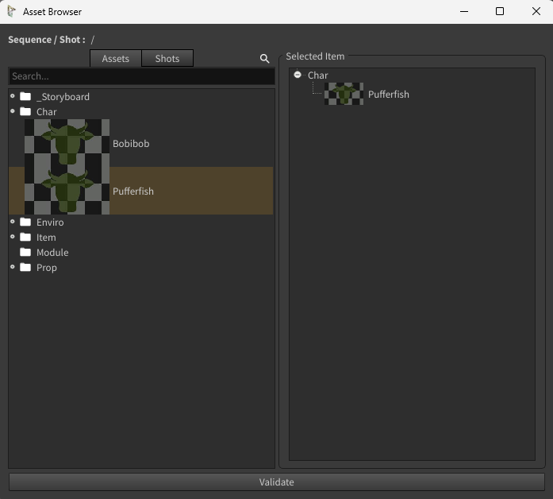
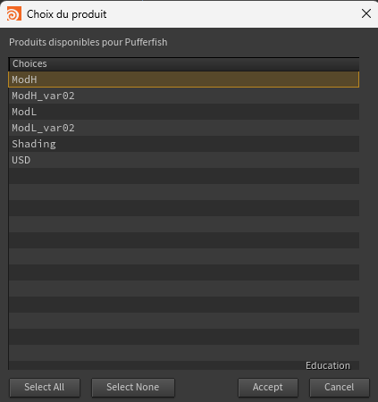

# HDA

Cette page sert à lister les HDA (c'est à dire les nodes custom) de Daisy Pipe. Ils sont accessibles dans le TAB menu d'Houdini mais uniquement dans le contexte de Solaris (stage). En voici la liste :

- [Daisy Create template](#create-template)
- [Daisy Import](#daisy-import)
- [Daisy Export](#daisy-export)
- [Daisy Lookdev scene](#daisy-lookdev-scene)
- [Daisy layout manager](#daisy-layout-manager)
- [Daisy camera frustrum](#daisy-camera-frustrum)
- [Daisy Save loaded paloads](#daisy-save-loaded-payloads)
- [Daisy Load saved payloads](#daisy-load-saved-payloads)
- [Daisy occlusion](#daisy-occlusion)

***

## Create Template
Ce node permet de créer un template pour chaque task de la production. Il est très simple d'utilisation : créez le node, clickez sur le bouton "Create template" et c'est fini.

!!! warning

    Il est important pour le bon déroulement des scripts d'avoir une scène vide, sans aucun node existant. Si vous avez des nodes avant de créer le template, ils risquent de rentrer en conflit les uns avec les autres et de perturber le placement du template.

Pour plus d'informations (et des informations détaillées), je vous invite à lire [la page dédiée aux templates](templates.md).

## Daisy Import
Voici un node que vous allez utiliser très souvent. Il permet d'importer la dernière version d'un product depuis Prism. Voici comment l'utiliser : 
Clickez sur le bouton "**Browse Asset**", une fenêtre s'ouvre, c'est l'Asset Browser. Cette fenêtre vous permet de choisir un asset à importer. Faites un **drag and drop de l'asset** que vous voulez importer dans la colonne de droite et clickez sur "**Validate**".

Une autre fenêtre s'ouvre pour choisir cette fois-ci le product que vous voulez importer. **Sélectionnez-le** et clickez sur "**Accept**". Voilà, c'est importé.

Ci dessous la liste des paramètres du node :

|Nom du paramètre|Description
|:---|:---
|Import as|Permet de choisir entre 2 méthodes d'import, la référence ou le sublayer
|Show path|Affiche le chemin d'import et permet de le modifier manuellement
|Brows Asset|Ouvre une fenêtre pour aller chercher l'asset dans Prism
|**Advanced Settings**|
|Layer break|Active un node de layer break qui permet d'ignorer tout ce qui se passe avant en créant un nouveau sublayer
|Maya scale|Adapte la taille des assets qui viennent de Maya pour les faire correspondre à l'échelle d'Houdini
|Use geometry sequence LOP for file sequences|Active l'import de séquence d'USD pour importer une animation
|Load payloads|Permet d'activer les potentiels payloads de l'import ou non
|Has variant|Si votre asset a un ou des variants, cette case ajoute de nouveaux paramètres pour choisir vos variants
|Uniform scale|Si la case "Maya scale" est cochée, permet de modifier l'échelle de l'asset
|Import path prefix|Si la case "Use geometry sequence LOP for file sequence" est cochée

## Daisy Export
Ce node node aussi, vous allez beaucoup l'utiliser. Comme son nom l'indique, il sert à faire des exports en USD.

Si vous voulez faire un export, vous pouvez ajouter la primitive que vous voulez exporter dans le paramètre "**Default Primitive**" puis clicker sur "**Save to Disk**". 
Contrairement au Daisy Import, ce node comporte **BEAUCOUP** de paramètres, en voici une liste non exhaustive :

|Nom du paramètre|Description
|:---|:---
|Animation Type|Type de fichier qui sort en cas d'animation, il y en a 2 types : - **time samples** : qui sort un fichier pout toute l'animation - **file per frame** : crée un fichier usd par frame
|Save to Disk|Bouton qui lance la sauvegarde
|Version|Permet de choisir la version à sauvegarder dans Prism (quand la case "Next" est cochée, les versions sont incrémentées automatiquement)
|Valid Frame Range|Sert à dire si on veut exporter une animation ou une frame seule
|Comment|Permet d'écrire un commentaire dans le product exporté
|Output Type|Type de fichier à exporter
|Maya Scale|Multiplie la taille de la scène par 100 pour respecterr la taille de Maya
|Uniform Scale|Si la case "Maya Scale" est cochée, permet de gérer le multiplicateur de taille
|Update Master Version|Permet de dire si on veut modifier la version master ou pas
|Update Thumbnail|Permet de créet une thumbnail ou pas
|Default Primitive|Ce paramètre est obligatoire, c'est la primitive que l'on veut exporter
|**Advanced Settings**|
|Use Config Layer|Permet de choisir si on veut utiliser le node configure layer qui rajoute des options d'export au layer
|Save Loaded Payloads|Permet de dire si on veut utiliser le node [Save Loaded Payloads](#daisy-save-loaded-payloads) ou pas

La suite des paramètres n'est qu'une succession de paramètres déjà existants dans les nodes d'Houdini que nous faisons remonter. 
Pour plus de paramètres, n'hésitez pas à vous référer à la documentation d'Houdini sur les nodes [configure layer](https://www.sidefx.com/docs/houdini/nodes/lop/configurelayer.html) et [usd rop](https://www.sidefx.com/docs/houdini/nodes/out/usd.html).

## Daisy Lookdev scene

## Daisy Layout Manager

## Daisy Camera Frustrum

## Daisy Save Loaded Payloads

## Daisy Load Saved Payloads

## Daisy Occlusion