# Solaris
[< page précédente](../houdini.md)

Cette page est une introduction à Solaris, le contexte Houdini qui sert à gérer l'USD. Ici nous partirons du principe que vous avez déjà les bases de l'USD. SI vous avez besoin de plus d'informations à ce sujet, vous pouvez vous rendre sur la [page de la doc dédiée à l'USD](../../overview/usd.md). 
Ce document est un peu long donc voici un sommaire de la page pour aller directement à la partie qui vous intéresse :

- [Solaris, qu'est-ce que c'est ?](#solaris-quest-ce-que-cest-)
- [Le viewport](#le-viewport)
- [Le Scene Graph Tree](#le-scene-graph-tree)
- [Le Scene Graph Layers](#le-scene-graph-layers)
- [Les nodes utils](#les-nodes-utils)

***

## Solaris, qu'est-ce que c'est ?
Tout d'abord, il faut savoir qu'houdini fonctionne en "**contextes**". "Mais qu'est-ce qu'un contexte ?" me demanderez-vous. Un contexte est une section d'Houdini spécialisée dans une tâche spécifique. Par exemple il existe un contexte pour gérer la géométrie (SOP), pour le compositing (COP ou Copernicus), pour les rendus (ROP) ou encore pour l'USD (LOP aussi appelé Solaris). 
Ce qui est plutôt pratique c'est que dans Houdini, vous pouvez passer très facilement d'un contexte à l'autre. Soit en créant un node (par exemple si je suis dans un SOP, je peux créer un node LOP et rentrer dedans pour accéder à Solaris), soit en allant en haut du node graph pour choisir un contexte.

Donc comment aller dans Solaris ? Assurez-vous que vous avez bien le petit logo orangé en haut du node editor.
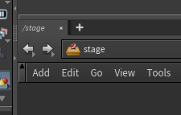 
Vous pouvez également changer la disposition des fenêtres en allant dans le menu déroulant tout en haut d'Houdini et en clickant sur "Solaris". 
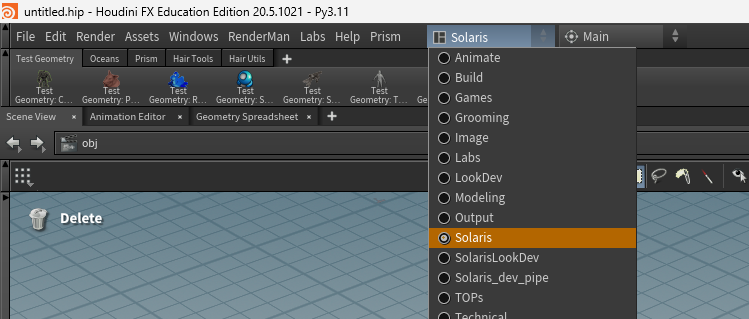 
À savoir que si vous avez créé votre scène avec Daisy Pipe, vous devriez automatiquement être dans Solaris avec une bonne disposition de fenêtres. Voici à quoi ressemblera Houdini après cette dernière manipulation. 

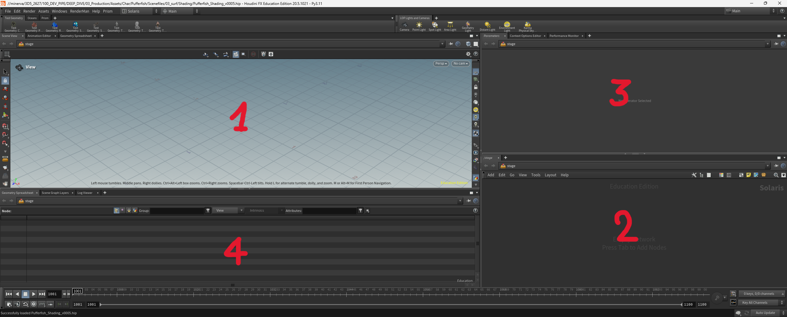
1. Le viewport
2. Le node editor
3. Les parameters
4. Le scene graph tree

Maintenant, pour plus de confort je vais modifier l'organisation des fenêtres (mais ça ne change rien, pas de panique). À partir de maintenant c'est cette disposition que j'utiliserai pour vous expliquer Houdini.

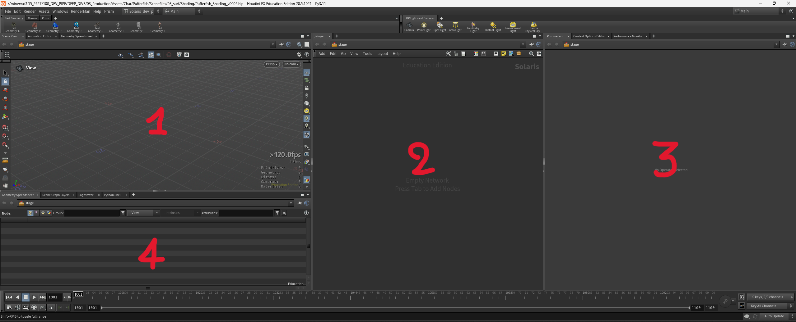

Maintenant que tout est prêt, il est temps de rentrer dans le vif du sujet.

***

## Le viewport
Comme dans tout logiciel de 3D le viewport est essentiel, il nous permet de voir ce qu'on fait. Il prend encore plus d'importance lors du rendu, notament en USD puisque l'un de ses principaux atouts est d'être compatible et directement compréhensible par tous les moteurs de rendu.

Tout d'abord, ces 2 menus vous seront très utils. 
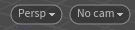 
Le premier vous permettra entre autre de lancer un IPR avec le moteur de rendu que vous voulez. Le second sert entre autre à prendre la vue d'une caméra. 

### Outils du viewport
À gauche vous trouverez les outils du viewport :
- les options de transform
- les options de snapping
- la render region (pour faire vos IPR sur une petite partie du viewport)
- l'inspecteur (pour avoir plein d'informations en un click sur la primitive ou le pixel que vous pointez)
- le flipbook (équivalent du playblast Maya, vous sert à enregistrer votre viewport)
- les snapshots (pour sauvegarder des instantanées du viewport) 
...

### Options d'outils
En haut vous avez les options d'outils, pour la sélection, la caméra, les transform ... 
Je vous laisse découvrir tout ça par vous même.

### Options d'affichage
Et à droite, vous retrouverez les paramètres d'affichage :
- les options d'affichage de lighting
- de material
- de rendu
...

Si vous voulez connaitre mes paramètres préférés, je vous les donne. Et si vous ne voulez pas ... Tant pis, je vous les donne quand même :

1. Si vous clickez sur la paire de lunettes
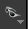
, vous pourrez choisir quelle version de géométrie afficher (proxy / render) 
Vous avez aussi d'autres options que je ne connais pas mais qui certainement très utiles. 
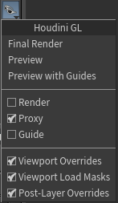

2. Ce petit cadenas
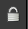
vous permet de faire bouger votre caméra ou votre light en naviguant dans le viewport. Pour cela il faut vous placer dans la vue de votre cam (ou light), actionner le cadenas et vous déplacer comme vous voulez, ça placera la caméra sur votre vue.

3. Cet icone de layers
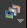
sert à afficher l'AOV de votre choix pendant vos IPR. C'est dingue ! C'est Fou ! C'est incroyable ! Calmez-vous ... C'est juste Houdini.

### Paramètres du Viewport
En passant votre souris dans le viewport et en appuyant sur D, vous pouvez ouvrir les paramètres de ce dernier. Vous pouvez accéder à beaucoup de paramètres différents comme :
- la couleur du background (dans Background/Color Scheme)
- le FOV de la caméra (dans Camera/Field of View)
- ou encore les info de la scène (dans Guides/Additionnal Information)

***

## Le Scene Graph Tree
Passons à la fenêtre qui fait peur ... 
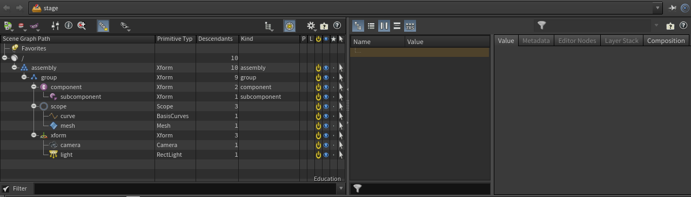

Alors, qu'est ce que c'est que cette horreur ? 
Je vous présente le "Scene Graph Tree", c'est l'équivalent de l'outliner de Maya, il présente la hiérarchie des primitives de la scène. Vous pouvez voir que la fenêtre est découpée en 2 parties :
- le scene graph tree (à gauche)
- le scene graph details (à droite)

### Le Scene Graph Tree
Commençons avec la partie de gauche. On peut voir une sorte de tableau découpé en 10 colonnes. Je pense que les premières colonnes sont assez explicites donc je vais vous parler des dernières.

> 
> À noter que les options que je vais présenter ci-dessous ne sont pas écrites dans les fichiers USD, elles ne sont effectives que dans le viewport pour cette scène. Elles ne sont pas non plus compatibles avec certains nodes, vous pourez donc les utiliser ponctuellement pour facilter votre travail en sachant bien que ce n'est pas la version finale de la scène.

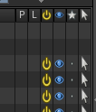

1. Le **P** représente le "**population mask**" il permet de définir les éléments qui seront dans un population mask (je ne m'attarderai pas dessus car nous avons choisis de ne pas l'utiliser dans le pipe mais d'utiliser les payloads à la place, si vous voulez ajouter cette fonctionnalité au votre vous pouvez sans problème). On peut passer par le node "configure stage" pour gérer les payloads de manière plus stable.
2. Le **L** permet de **load ou unload les payloads**. On peut passer par **le node "configure stage"** pour gérer les payloads de manière plus stable, c'est d'ailleurs ce node qui est utilisé dans les outils du pipe. 
> 
> Les 2 options précédentes ne sont activables que si vous désactivez les options "Populate all primitives in viewport" (pour les population masks) ou "Load all payloads in viewport" (pour les payloads) dans "Manage viewport load masks"
>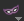
> en haut. 
3. Le **bouton d'activation jaune** sert à **activer ou non une primitive**. On peut aussi passer par **le node "prune"** pour le gérer de manière plus stable.
4. L'**oeil bleu** sert à **cacher une primitive** ou non. C'est la fonctionnalité qui se rapproche le plus de la fonction hide de Maya.
5. La petite **étoile** sert à afficher seulement la primitive sélectionnée. C'est le "**solo mode**".
6. Le **curseur de souris** permet de **définir si une primitive est sélectionnable** ou non.

En bas du scene graph tree, vous retrouvez de quoi filtrer vos primitives pour les retrouver plus facilement. Vous pouvez écrire le nom d'une primitive ou une expression pour plus de souplesse.

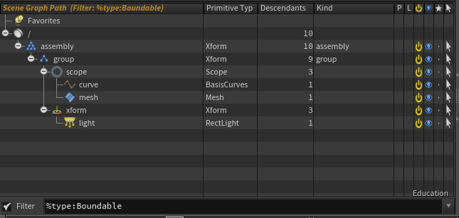

En haut du scene graph tree, il y a un panneau d'outils pour effectuer plusieurs actions. Je dois vous avouer que je ne connais pas tous ces menus mais en voici quelques uns utils.

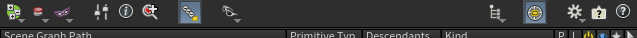

1. Le **bouton rouge**
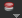
sur le deuxième emplacement sert à gérer les **overrides du viewport**. Lorsqu'une primitive est accompagnée d'un point rouge, ça veut dire qu'elle est override, c'est à dire qu'elle a été modifiée d'une manière ou d'une autre. Mais ce point rouge n'est valable que pour les overrides spécifiques au viewport. Le gestionnaire d'override permet donc d'enregistrer les overrides du viewport ou de tous les désactiver pour retrouver votre scène originale. 
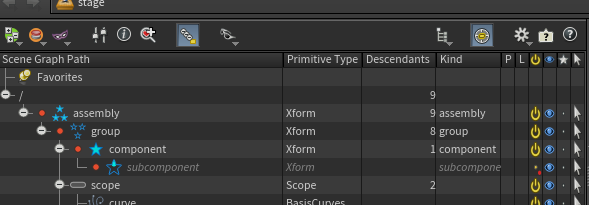
2. Le **masque violet**

à côté du gestionnaire d'override permet de **gérer les "load masks"**. Mais qu'est-ce que c'est ? C'est un ensemble de fonctionnalités qui permettent de load ou non des primitives ou des layers. C'est ici par exemple que vous pouvez choisir de load tous les payloads ou non, pareil pour les population masks, ou encore de mute un layer entier.
3. La **loupe rouge**

sert à gérer les selection rules, c'est à dire les filtres. 
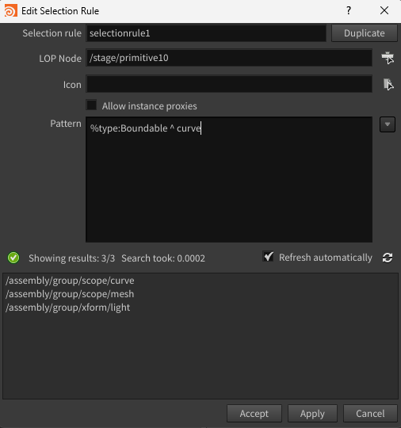

***À suivre ...***

***

## Le Scene Graph Layers

***

## Les nodes utils

[< page précédente](../houdini.md) - 
[page suivante >](templates.md) 
*Daisy Pipeline 2026 - by Noa Escourbanies, Leeloo Trinh-Thieu and Thomas Rubio*