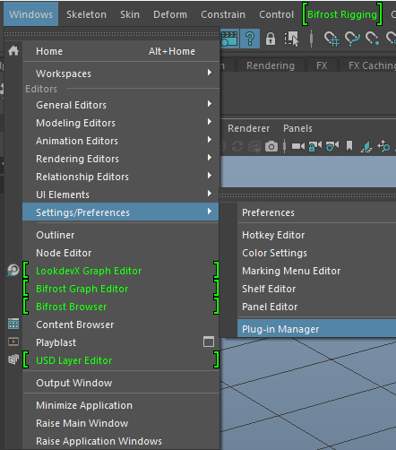
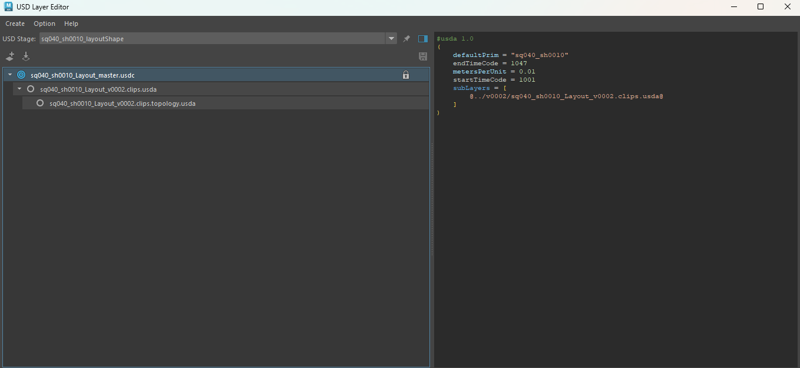
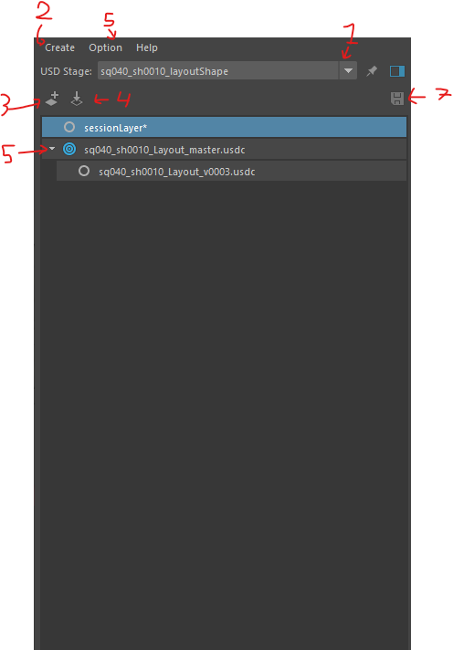
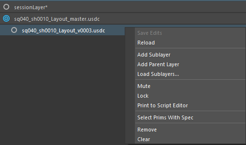

# Maya
[< page précédente](../maya.md)  

Cette page a pour but de documenter l'utilisation de l'entièreté du pipeline alembic et USD, de la hiérarchie des groupes,
à comment passer d'un departement a un autre au sein de Maya.
Dans cette documentation nous partirons du principe que vous connaissez un minimum ***Maya***. Nous partirons également du principe que vous connaissez  ***[les principes de base de l'USD](../overview/usd.md)*** que nous avons expliqué dans cette documentation.  

Voici un petit sommaire pour vous aider :

- [L'USD dans Maya](#lusd-dans-maya)
  - [USD Layer Editor](#usd-layer-editor)
  - [Créer et charger un stage](maya_stage.md)
  - [Édition : target layer et Edit As Maya Data](maya_edition.md)
  - [Import, export et unités](maya_import_export.md)
  - [Matériaux et RenderMan](maya_materiaux.md)
  - [Références, payloads et variants](maya_references_variants.md)
  - [Problèmes connus](maya_problemes_connus.md)

## L'USD dans Maya

Tout d'abord, avant de vouloir tout passer en USD, il faut être conscient de plusieurs points concernant l'USD dans Maya.
Les prims USD (affichés via le proxy shape de maya-usd) et les nodes Maya natifs peuvent coexister dans la même scène, mais ils ne vivent pas dans le même graphe.
Les outils Maya comme les deformers, les contraintes ou le rig ne peuvent donc pas agir directement sur les prims USD. Pour les modifier,
il faut passer par _"l'outliner"_ USD, ou utiliser « Edit As Maya Data » puis renvoyer les changements vers le stage.

> 
>Pour plus d'informations sur l'USD Maya, retrouvez la ***[documentation officielle ici](https://help.autodesk.com/view/MAYAUL/2026/ENU/?guid=GUID-9E9D45F2-4DA9-497B-8D69-1573ED6B2BA8)***.

Comment accéder aux outils USD de Maya ? Assurez-vous d'avoir le mayaUsdPlugin de Maya activé. Pour vérifier, allez dans : Windows → Settings/Preferences → Plug-in Manager, 
et vérifiez que le plugin mayaUsdPlugin est coché.

 

### Usd Layer Editor

Une fois le plugin actif, vous pouvez ouvrir la fenêtre _USD Layer Editor_, qui permet de gérer les layers d'un stage USD (sublayers, ordre, layer cible d'édition).
Pour parcourir la hiérarchie des prims, utilisez l'Outliner de Maya en dépliant le proxy shape.
  
 

L'editor est divisé en 2 parties:

1. L'arbre des layers
2. le Layer data Window

Dans l'arbre, vous retrouvez le root layer du stage et ses sublayers, classés du plus fort au plus faible (le layer du haut l'emporte sur ceux du dessous).
Chaque layer affiche à droite de son nom des icônes pour le définir comme target layer (celui qui reçoit les modifications), le verrouiller ou le muter.
Un astérisque apparaît à côté d'un layer qui contient des modifications non sauvegardées.
Un clic droit sur un layer ouvre un menu contextuel avec les actions disponibles.
  
 

 

| N° | Élément | Description |
|---|---|---|
| 1 | Sélecteur USD Stage | Choisit le stage dont les layers sont affichés dans l'arbre. |
| 2 | Menu Create | Crée un stage, soit vide (Stage with New Layer), soit depuis un fichier (Stage from File). |
| 3 | Add a new layer | Ajoute un nouveau layer anonyme à côté du layer sélectionné. Si aucun layer n'est sélectionné, il est ajouté sous le root layer. |
| 4 | Load an existing layer | Charge un fichier USD existant comme sublayer du layer sélectionné, ou du root layer si aucun n'est sélectionné. |
| 5 | Menu Option | Contient notamment Auto-Hide Session Layer, qui masque automatiquement le session layer. |
| 6 | Flèche de dépliage | Affiche ou masque les sublayers d'un layer. |
| 7 | Save Stage | Enregistre en une fois toutes les modifications non sauvegardées du stage. |

| Action | Description |
|---|---|
| Save Edits | Enregistre sur le disque les modifications non sauvegardées du layer. Grisé tant que le layer n'a pas été modifié. |
| Reload | Recharge le layer depuis son fichier sur le disque. Les modifications non sauvegardées sont perdues. |
| Add Sublayer | Ajoute un nouveau layer vide (anonyme) comme sublayer du layer sélectionné. |
| Add Parent Layer | Crée un nouveau layer au-dessus du layer sélectionné, qui devient alors son sublayer. |
| Load Sublayers… | Ouvre un explorateur pour charger un ou plusieurs fichiers USD existants comme sublayers du layer sélectionné. |
| Mute | Désactive le layer. Le stage l'ignore et son contenu disparaît du viewport et de l'Outliner, sans être supprimé. |
| Lock | Verrouille le layer. Il ne peut plus être défini comme target layer ni recevoir de sublayers. |
| Print to Script Editor | Affiche le contenu du layer, au format texte USD (usda), dans le Script Editor. |
| Select Prims With Spec | Sélectionne les prims qui ont une description (spec) dans ce layer, c'est-à-dire ceux que le layer modifie ou définit. |
| Remove | Retire le layer de la pile de layers du stage. Le fichier n'est pas supprimé du disque. |
| Clear | Vide le contenu du layer, mais le garde dans la pile. |

La Layer Data Window affiche le contenu du layer sélectionné au format texte USD (usda).
On y trouve les métadonnées du layer (prim par défaut, plage de frames, cadence, unité, axe vertical), puis la hiérarchie des prims avec leurs références, transformations et attributs.
C'est l'outil à utiliser pour contrôler les références d'un layer ou comprendre l'origine d'une valeur.

[< page précédente](../maya.md) -
[page suivante >](../houdini.md)  

*Daisy Pipeline 2026 - by Noa Escourbanies, Leeloo Trinh-Thieu and Thomas Rubio*