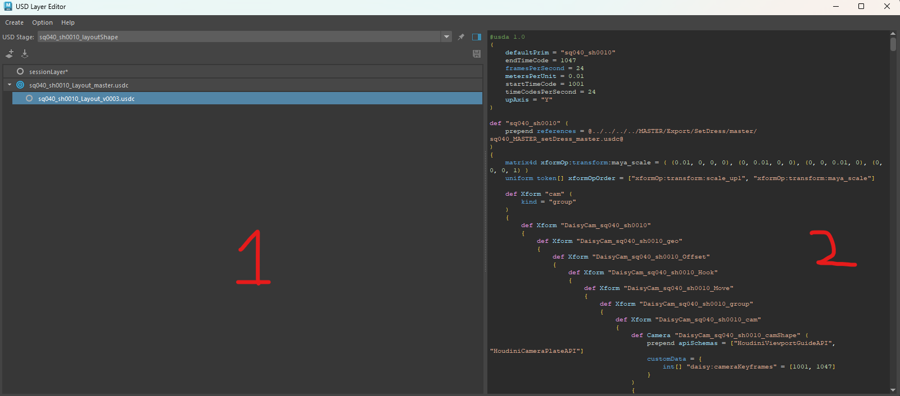

# Maya

Cette page a pour but de documenter l'utilisation de l'entièreté du pipeline alembic et USD, de la hiérarchie des groupes,
à comment passer d'un departement a un autre au sein de Maya.
Dans cette documentation nous partirons du principe que vous connaissez un minimum ***Maya***. Nous partirons également du principe que vous connaissez  ***[les principes de base de l'USD](../../overview/usd.md)*** que nous avons expliqué dans cette documentation.

Sommaire

1. [L'USD dans Maya](#lusd-dans-maya)
2. [Créer et charger un stage](#creer-et-charger-un-stage)
3. [Édition : target layer et Edit As Maya Data](#edition-target-layer-et-edit-as-maya-data)
4. [Import, export et unités](#import-export-et-unites)
5. [Matériaux et RenderMan](#materiaux-et-renderman)
6. [Problèmes connus](#problemes-connus)

## L'USD dans Maya

Tout d'abord, avant de vouloir tout passer en USD, il faut être conscient de plusieurs points concernant l'USD dans Maya.
Les prims USD (affichés via le proxy shape de maya-usd) et les nodes Maya natifs peuvent coexister dans la même scène, mais ils ne vivent pas dans le même graphe.
Les outils Maya comme les deformers, les contraintes ou le rig ne peuvent donc pas agir directement sur les prims USD. Pour les modifier,
il faut passer par _"l'outliner"_ USD, ou utiliser « Edit As Maya Data » puis renvoyer les changements vers le stage.

!!! info

    Pour plus d'informations sur l'USD Maya, retrouvez la ***[documentation officielle ici](https://help.autodesk.com/view/MAYAUL/2026/ENU/?guid=GUID-9E9D45F2-4DA9-497B-8D69-1573ED6B2BA8)***.

Comment accéder aux outils USD de Maya ? Assurez-vous d'avoir le mayaUsdPlugin de Maya activé. Pour vérifier, allez dans : Windows → Settings/Preferences → Plug-in Manager, 
et vérifiez que le plugin mayaUsdPlugin est coché.

### Usd Layer Editor

Une fois le plugin actif, vous pouvez ouvrir la fenêtre _USD Layer Editor_, qui permet de gérer les layers d'un stage USD (sublayers, ordre, layer cible d'édition).
Pour parcourir la hiérarchie des prims, utilisez l'Outliner de Maya en dépliant le proxy shape.
  

L'editor est divisé en 2 parties:

1. L'arbre des layers
2. le Layer data Window

Dans l'arbre, vous retrouvez le root layer du stage et ses sublayers, classés du plus fort au plus faible (le layer du haut l'emporte sur ceux du dessous).
Chaque layer affiche à droite de son nom des icônes pour le définir comme target layer (celui qui reçoit les modifications), le verrouiller ou le muter.
Un astérisque apparaît à côté d'un layer qui contient des modifications non sauvegardées.
Un clic droit sur un layer ouvre un menu contextuel avec les actions disponibles.
  

 

| N° | Élément | Description |
|---|---|---|
| 1 | Sélecteur USD Stage | Choisit le stage dont les layers sont affichés dans l'arbre. |
| 2 | Menu Create | Crée un stage, soit vide (Stage with New Layer), soit depuis un fichier (Stage from File). |
| 3 | Add a new layer | Ajoute un nouveau layer anonyme à côté du layer sélectionné. Si aucun layer n'est sélectionné, il est ajouté sous le root layer. |
| 4 | Load an existing layer | Charge un fichier USD existant comme sublayer du layer sélectionné, ou du root layer si aucun n'est sélectionné. |
| 5 | Menu Option | Contient notamment Auto-Hide Session Layer, qui masque automatiquement le session layer. |
| 6 | Flèche de dépliage | Affiche ou masque les sublayers d'un layer. |
| 7 | Save Stage | Enregistre en une fois toutes les modifications non sauvegardées du stage. |

| Action | Description |
|---|---|
| Save Edits | Enregistre sur le disque les modifications non sauvegardées du layer. Grisé tant que le layer n'a pas été modifié. |
| Reload | Recharge le layer depuis son fichier sur le disque. Les modifications non sauvegardées sont perdues. |
| Add Sublayer | Ajoute un nouveau layer vide (anonyme) comme sublayer du layer sélectionné. |
| Add Parent Layer | Crée un nouveau layer au-dessus du layer sélectionné, qui devient alors son sublayer. |
| Load Sublayers… | Ouvre un explorateur pour charger un ou plusieurs fichiers USD existants comme sublayers du layer sélectionné. |
| Mute | Désactive le layer. Le stage l'ignore et son contenu disparaît du viewport et de l'Outliner, sans être supprimé. |
| Lock | Verrouille le layer. Il ne peut plus être défini comme target layer ni recevoir de sublayers. |
| Print to Script Editor | Affiche le contenu du layer, au format texte USD (usda), dans le Script Editor. |
| Select Prims With Spec | Sélectionne les prims qui ont une description (spec) dans ce layer, c'est-à-dire ceux que le layer modifie ou définit. |
| Remove | Retire le layer de la pile de layers du stage. Le fichier n'est pas supprimé du disque. |
| Clear | Vide le contenu du layer, mais le garde dans la pile. |

La Layer Data Window affiche le contenu du layer sélectionné au format texte USD (usda).
On y trouve les métadonnées du layer (prim par défaut, plage de frames, cadence, unité, axe vertical), puis la hiérarchie des prims avec leurs références, transformations et attributs.
C'est l'outil à utiliser pour contrôler les références d'un layer ou comprendre l'origine d'une valeur.

## Créer et charger un stage

Cette section explique comment créer un stage USD dans Maya et comment Maya l'affiche.

### Créer ou charger un stage

Un stage est un fichier USD racine et l'ensemble de ses layers. Dans Maya, il est affiché dans la scène par un node appelé _proxy shape_, qui apparaît dans l'Outliner. C'est en dépliant ce node que vous retrouvez la hiérarchie des prims.

Il existe deux façons de créer un stage :

| Option | Description |
|---|---|
| Stage with New Layer | Crée un stage vide, avec un nouveau layer anonyme. |
| Stage from File | Crée un stage à partir d'un fichier USD existant. Un explorateur s'ouvre pour choisir le fichier. |

Ces deux options sont disponibles dans le menu _Create_ de l'USD Layer Editor, ainsi que dans le menu _Create_ de Maya, sous _Universal Scene Description (USD)_.

### Choisir le stage affiché dans le Layer Editor

En haut de l'USD Layer Editor, le sélecteur _USD Stage_ indique le stage dont les layers sont affichés. Par défaut, il suit ce que vous sélectionnez dans l'Outliner : si vous cliquez sur un prim d'un autre stage, l'éditeur change de stage.

Le bouton _Pin_, à côté du sélecteur, fige ce choix. Le stage reste affiché même si vous sélectionnez autre chose dans l'Outliner, ce qui est pratique quand une scène contient plusieurs stages. Activer le pin déclenche une sauvegarde de la scène Maya, et son état est conservé d'une session à l'autre.

### Sauvegarder le stage

Le bouton _Save Stage_, en haut à droite de l'arbre des layers, enregistre en une fois toutes les modifications non sauvegardées du stage. Le nombre de modifications en attente est affiché à côté de l'icône. Pour sauvegarder un seul layer, utilisez _Save Edits_ dans son menu contextuel.

!!! info
        
    Pour plus d'informations sur le Layer Editor, retrouvez la ***[documentation officielle ici](https://help.autodesk.com/view/MAYAUL/2026/ENU/?guid=GUID-4FAD73CA-E775-4009-9DCB-3BC6792C465E)***.

## Édition : target layer et Edit As Maya Data

Cette section explique où vont les modifications faites sur un stage USD dans Maya, et comment éditer un prim avec les outils Maya.

### Le target layer

Toute modification faite dans la scène (manipulateur, Attribute Editor, Outliner) est écrite dans le _target layer_. Pour définir un layer comme target, passez la souris à droite de son nom dans l'USD Layer Editor et cliquez sur l'icône grise de target. Elle est surlignée une fois le layer actif.

Dans une pile de layers, le layer du haut est le plus fort : ses valeurs l'emportent sur celles des layers du dessous. Il est donc recommandé de toujours éditer dans un layer fort et jamais dans un layer faible. Les modifications faites dans un layer plus faible que celui qui contient déjà une valeur sont bloquées, car le layer plus fort prendrait de toute façon le dessus.

### Session layer et root layer

| Layer | Rôle |
|---|---|
| Session layer | Layer tout en haut de la pile, dédié aux modifications temporaires. Son contenu n'est pas enregistré dans le fichier USD du stage. |
| Root layer | Layer principal du stage. C'est lui qui contient les sublayers. |

Le menu _Option_ de l'USD Layer Editor propose _Auto-Hide Session Layer_ pour masquer automatiquement le session layer dans l'arbre.

### Edit As Maya Data

Comme les prims USD ne vivent pas dans le même graphe que les nodes Maya, les outils Maya natifs (deformers, contraintes, rig) ne peuvent pas agir directement dessus. _Edit As Maya Data_ permet de contourner ce point.

Faites un clic droit sur le prim dans l'Outliner et choisissez _Edit As Maya Data_. Le prim est converti en nodes Maya que vous pouvez modifier avec les outils habituels. Une fois les modifications terminées, deux choix sont possibles : _Merge Maya Edits to USD_ renvoie les changements vers le stage, _Discard Maya Edits_ les annule et revient au prim d'origine.

!!! info

    Avant de merger, vérifiez quel layer est défini comme target layer, afin que les changements arrivent dans le bon layer.

## Import, export et unités

Cette section explique comment importer et exporter de l'USD avec Maya, et comment gérer les unités.

### Import ou stage ?

Il y a deux manières d'amener de l'USD dans une scène Maya, qui n'ont pas du tout le même effet.

| Méthode | Résultat |
|---|---|
| Créer un stage depuis un fichier | Le contenu reste de l'USD. Il est affiché par le proxy shape et reste lié à son fichier. |
| File → Import | Les données USD sont converties en données Maya natives. Il n'y a plus de lien avec le fichier d'origine. |

Pour un travail en pipeline, on privilégie le stage, qui conserve les layers et les références.

### Exporter vers l'USD

Pour exporter, utilisez _File → Export All_ ou _File → Export Selection_ et choisissez le format USD. La fenêtre d'options propose notamment les réglages suivants :

| Option | Description |
|---|---|
| Subdivision | Méthode de subdivision écrite dans le fichier. Voir la section [problèmes connus](#problemes-connus) pour le cas des normales. |
| USD Preview Surface | Écrit un matériau USD Preview Surface en plus du matériau Maya. Voir la section [matériaux](#materiaux-et-renderman). |
| Color Sets et UV Sets | Exportent les sets de couleurs et d'UV du maillage. À activer si vous en avez besoin dans la suite du pipeline. |

### Unités et échelle

Maya travaille par défaut en centimètres, alors que l'USD stocke l'unité de la scène dans la métadonnée `metersPerUnit`. Une valeur de 0.01 correspond à des centimètres, une valeur de 1 à des mètres.

Dans le layout de l'exemple, la Layer Data Window montre un `metersPerUnit` à 0.01 ainsi qu'une matrice `maya_scale` à 0.01 sur le prim racine. En cas de problème d'échelle, c'est le premier endroit à contrôler.

!!! tip

    Si l'échelle est incorrecte après l'import d'un asset venant d'un autre logiciel (Houdini de jeu par exemple), commencez par remettre à l'échelle l'asset en changeant la scale de l'usd dans l'attribute editor.

## Matériaux et RenderMan

Cette section explique comment gérer les matériaux avec l'USD dans Maya, et pourquoi les matériaux RenderMan posent problème.

### Matériaux Maya et USD Preview Surface

Pour qu'un matériau soit correctement traduit en USD, utilisez un matériau Maya Surface, Lambert ou Phong. Ce sont eux qui donnent les meilleurs résultats à l'export.

Le principe est le suivant : appliquez le matériau sur vos objets dans Maya, puis exportez en USD en vous assurant que l'option _USD Preview Surface_ est activée dans la fenêtre d'options d'export. Activez aussi _Color Sets_ et _UV Sets_. Pour tester le résultat, créez un stage depuis le fichier exporté : le matériau doit apparaître dans le viewport.

Pour un matériau Arnold, l'export passe par le menu Arnold, qui propose son propre export USD (_Export All_ ou _Export Selection_).

### Matériaux RenderMan

Les matériaux RenderMan ne fonctionnent pas dans Maya lorsqu'ils sont portés par un stage USD. Ils ne sont pas pris en charge par le proxy shape : ils ne s'affichent pas dans le viewport et ne sont pas éditables depuis Maya.

Concrètement, le viewport Maya ne permet pas de juger l'aspect final d'un asset destiné à RenderMan. Si vous avez besoin d'un aperçu dans Maya, assignez en plus un matériau compatible (Maya Surface, Lambert, Phong ou USD Preview Surface), et conservez le matériau RenderMan pour le rendu dans houdini.

>Un asset qui s'affiche gris ou uni dans Maya n'est donc pas forcément cassé : vérifiez son matériau dans l'outil prévu pour le rendu avant de conclure à une erreur.

## Problèmes connus

Cette section regroupe les problèmes courants rencontrés avec l'USD dans Maya, et leur solution.

| Problème | Solution |
|---|---|
| Les couleurs écrites dans `displayColor` présentent un décalage gamma après l'export. | Définir la variable d'environnement `PIXMAYA_LINEAR_COLORS` sur `true` avant de lancer Maya. |
| L'échelle est incorrecte à l'import d'un asset venant d'un autre logiciel. | Mettre à jour le plugin maya-usd vers la dernière version disponible sur GitHub. |
| Les normales sont cassées après un export puis une réimportation dans Maya 2026. | Dans les options d'export USD, régler la méthode de subdivision sur _None (polygonal mesh)_. |
| Impossible d'éditer ou de cibler un layer. | Vérifier que le layer n'est pas verrouillé, qu'il n'est pas en lecture seule, et que vous n'éditez pas dans un layer plus faible que celui qui contient déjà la valeur. |
| Les matériaux RenderMan ne s'affichent pas. | Ils ne sont pas pris en charge dans Maya. Voir la section [matériaux](#materiaux-et-renderman). |