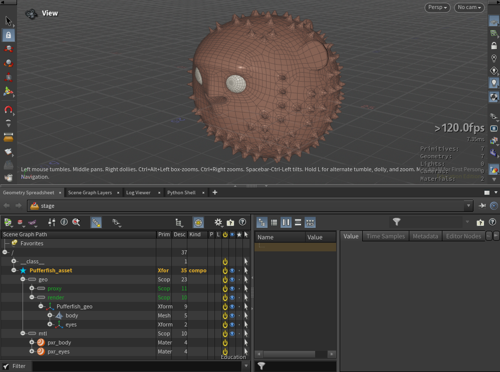
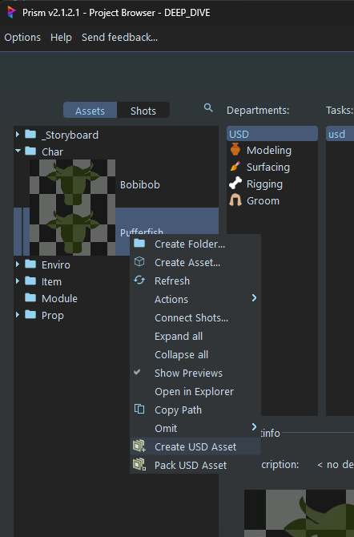
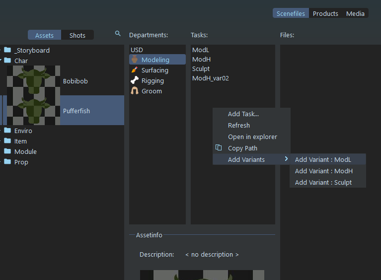
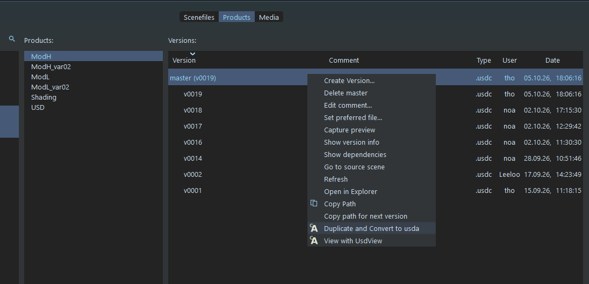
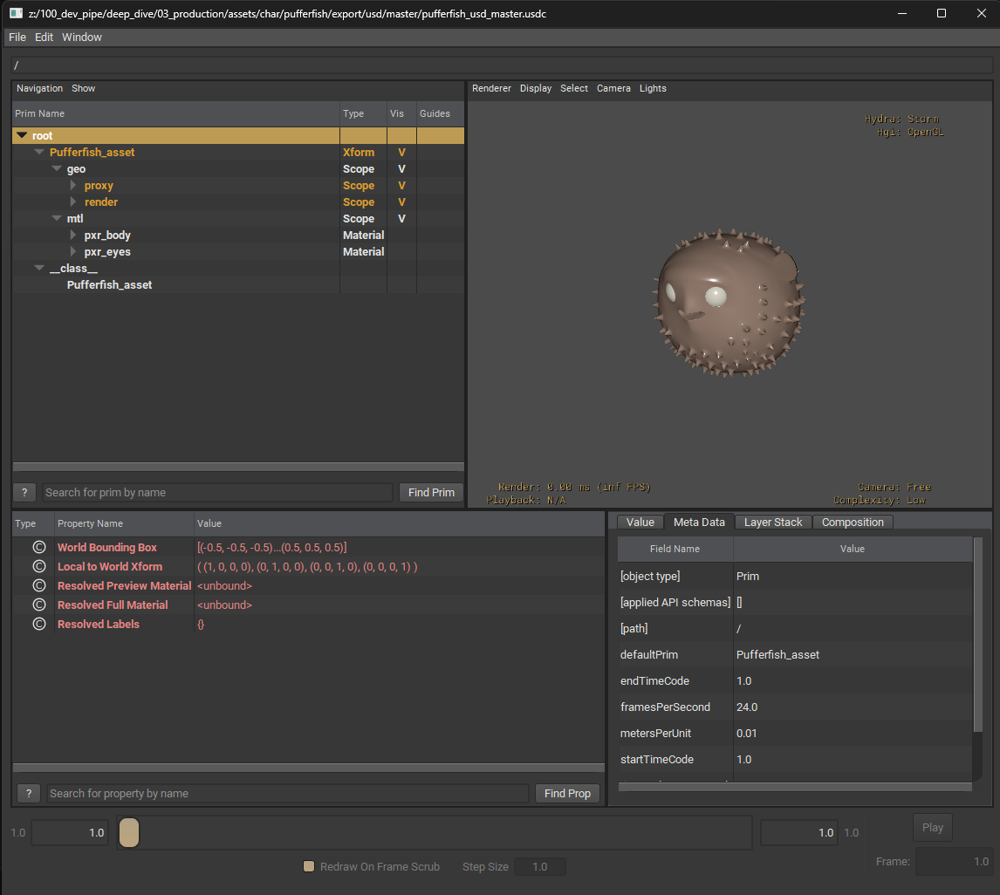

# Prism (Daisy Pipe)
[< page précédente](../daisy_pipe.md)

Daisy Pipeline est un plugin Prism, il intègre des fonctionnalités sur Houdini et Maya mais aussi dans Prism lui même. Cette page fait l'inventaire de ces fonctionnalités, certaines plus importantes que d'autres mais toutes très utiles. Voici ce qu'elle contient :

- [Create USD asset](#create-usd-asset)
- [Pack USD asset](#pack-usd-asset)
- [Add variant](#add-variant)
- [Duplicate and convert USD](#duplicate-and-convert-usd)
- [View with usdview](#view-with-usdview)

## Create USD asset
Commençons avec l'une des actions que vous allez le plus utiliser dans Prism. Le "Create USD Asset". Mais qu'est-ce que c'est ? 
Tout d'abord il faut comprendre ce qu'est un **asset** en USD. C'est un fichier USD qui va en référencer d'autres pour n'avoir à appeler qu'un seul fichier par la suite. **C'est une sorte de grosse boite dans laquelle on met la geo, le groom, les shaders ...**

Par exemple, j'ai un asset de poisson. Je lui ai créé une geo et un shader, que j'ai exporté en 2 USD séparés. Je vais créer un asset USD pour combiner ma geo et mon shader dans un seul fichier qui référencera les 2. Comme ça, si je veux retoucher la geo et que quelqu'un veut modifier le shader, on pourra le faire en même temps et l'asset final sera mis à jour automatiquement.

Cette fonctionnalité d'asset USD permet également d'ajouter des éléments propres à l'USD comme :
- la création de variants
- la gestion de proxys
- la création de payloads
- la gestion des primitives avec une classe

Maintenant vous vous dites peut-être : "Ok super, t'es bien gentil mais comment on le crée ton asset de poisson ?". Très bonne question cher ami pêcheur !

Tout d'abord **ouvrez Prism** (de préférence pas depuis un logiciel, ouvrez directement Prism). Ensuite, faites un **click droit sur un asset** et choisissez "**Create USD Asset**".

> 
>On peut aussi noter que cette fonction crée un fichier Houdini qui sert à créer l'asset en question. Cette scène peut-être utile pour débugger les potentiels problèmes qui peuvent arriver pendant la création mais aussi pour aporter des moidifications à droite, à gauche à l'asset (si vous faites ça pensez bien à sauvegarder une copie, sinon le fichier sera écrasé au prochain "create USD asset").

## Pack USD asset
Il existe une autre façon de créer un asset USD, cette manière permet de compresser l'asset dans seulement quelques fichiers. Contrairement au "create USD asset" classique qui référence tous les layers, ce qui peut être assez lourd pour une configuration réseau inadaptée à l'USD. C'est pourquoi le "Pack USD Asset" existe, pour être plus supportable pour une render farm. Ça fera des fichiers plus lourds mais beaucoup moins nombreux au lieu de plein de petits fichiers légers.

> 
>Attention, si vous utilisez cette fonction, la mise à jour des différents layers de l'asset ne se fera plus automatiquement, il est donc conseillé de l'utiliser quand l'asset est plus ou moins finalisé. 
>Mais pas de panique, si vous avez fait un pack de votre asset, vous pouvez toujours le mettre à jour en en refaisant un nouveau. Vous pouvez aussi faire un create USD asset classique pour remplacer le pack et remettre la mise à jour automatique.

Comment faire ? De la même manière que pour le "Create USD Asset", **allez dans Prism**, faites un **click droit sur votre asset** et choisissez "**Pack USD Asset**".

## Add variant
Pour ajouter un variant, il est important de créer une nouvelle task dans Prism avec un format de nom bien particulier. Pour vous éviter des problèmes de nommage, nous vous avons créé une fonction "Add Variant" qui vous permet d'ajouter un variant dans une task spécifique. 
Comment procéder ? Commencez par sélectionner votre asset, puis votre département. Ensuite, faites un click droit dans les tasks, choisissez "Add Variant" et clickez sur la task qui vous intéresse. Une nouvelle task sera créée avec le nom "\<task\>_var\<nombre du variant\>". 

> 
>Les noms des variants seront toujours créés selon ce format de nom (sinon ils ne seraient pas reconnus par la suite). Nous vous conseillons donc pour les différencier de garder sous la main un tableau qui répertorie tous vos variants avec au moins leur nom et une description.

## Duplicate and convert USD
En USD, il y a plusieurs formats de fichiers : usd, usda, usdc, usdz, usdnc ... Dans Daisy Pipe, nous utilisons majoritairement l'usdc (Universal Scene Description Crate) qui est le format USD compilé (et qui permet donc de meilleurs performances). Mais parfois, Nous avons besoin de lire ce qu'il y a à l'intérieur de notre fichier USD, c'est là que le format usda (Universal Scene Description ASCII) intervient. Il est donc très intéressant d'avoir la possibilité de convertir les usdc en usda et inversement.

C'est là que l'outil usdcat intervient, il permet justement ce type de manipulation mais n'est disponible qu'en ligne de commande. Nous l'avons donc directement implémenté dans le pipe pour plus de facilité d'utilisation.

Mais comment faire ? Tout d'abord, **rendez-vous sur Prism, dans les products** (d'un asset ou d'un shot peu importe). **Sélectionnez le département et la task**, puis faites un **click droit sur la version que vous voulez convertir**. Sélectionnez "**Duplicate and Convert to usda**". Comme son nom l'indique, cette fonction créera une copie de votre fichier usdc en usda, il suffira d'aller le chercher par la suite dans votre explorateur de fichiers et de l'ouvrir.

> 
>Vous pouvez aussi convertir des usda en usdc, les manipulations seront les mêmes. À noter que le script fonctionne aussi avec le format USD (qui se comporte comme l'usdc et qui peut donc être convertit en usda).

> 
>Pensez bien que Daisy Pipeline ne lit qu'un seul type d'USD (celui que vous avez configuré dans le fichier config.json). Donc si vous convertissez votre fichier usdc en usda, le fichier usda ne sera pas lu par la suite (sauf si vous avez changé le config.json), il sert juste à lire le contenu de l'USD.

## View with UsdView
Parfois, on peut avoir envie de visualiser et inspecter un fichier USD sans ouvrir un gros logiciel comme Houdini. La solution : UsdView. 
UsdView est un petit logiciel proposé par Pixar qui permet de voir le contenu d'un fichier USD (non pas son code mais son contenu 3D). Il offre aussi des outils pour lire les attributs de chaque primitive, vizualiser les proxys, les variants ... Comme le fait Solaris.

Malheureusement, il n'est utilisable qu'à partir d'une ligne de commande. C'est pourquoi nous l'avons implanté dans Daisy Pipeline. Mais comment l'utiliser ? **Allez dans Prism, dans les products**. **Sélectionnez le départment puis la task**. Faites un **click droit sur la version que vous voulez** et choisissez "**View with UsdView**". Le logiciel peut mettre un peu de temps à se lancer la première fois mais les suivantes il est plus rapide.

Voici à quoi ressemble l'interface d'UsdView. Pour en apprendre plus sur l'utilisation d'UsdView, voici [une bonne ressource](https://docs.omniverse.nvidia.com/usd/latest/usdview/user_interface.html).

[< page précédente](../daisy_pipe.md) - 
[page suivante >](departments.md) 
*Daisy Pipeline 2026 - by Noa Escourbanies, Leeloo Trinh-Thieu and Thomas Rubio*