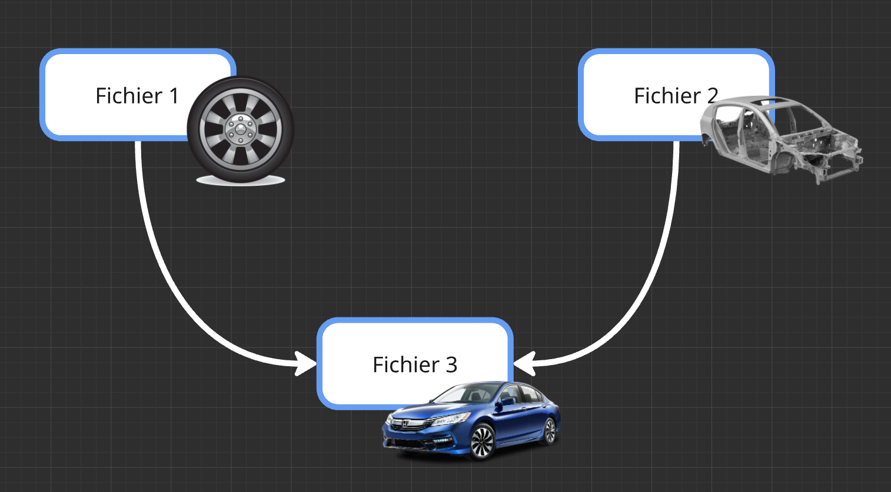
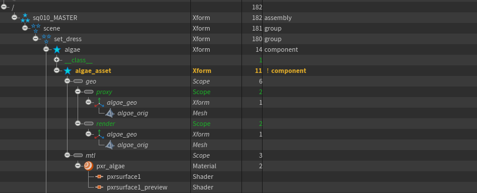

# USD
[< page précédente](../overview.md) 
Bienvenue dans une partie importante de cette documentation : la compréhension de l'USD et de certains de ses concepts. Je sais que c'est un gros morceau un peu flou. Dans un premier temps il est possible que vous ne compreniez pas tout, mais à force d'utilisation et de manipulations vous finirez par vous en sortir ne vous en faites pas. 
Cette page n'est pas une présentation exhaustive des concepts de l'USD qui sont beaucoup trop nombreux pour rentrer dans une seule page. C'est pourquoi je vous met ici [la documentation officielle](https://openusd.org/release/index.html) qui sera plus détaillée, anisi qu'un [glossaire des concepts liés à l'USD](https://openusd.org/release/glossary.html).

<a href="https://youtu.be/SaBXE4yQetk?si=AtESIyEA6WNDqib4" target="blank">Lien vers une vidéo de présentation de l'USD</a> 
<a href="https://developer.apple.com/videos/play/wwdc2022/10129/" target="blank">Lien vers une autre vidéo</a>

> 
>À savoir que cette documentation a été rédigé pour vulgariser au maximum l'USD, elle contient donc certaines approximations. De plus l'USD étant un sujet dense et complexe, il est également possible que nous commettions des erreurs dans certaines définitions.

Voici un petit sommaire pour naviguer plus facilement sur cette page :

- [Présentation générale](#présentation-générale)
- [Layer](#layer)
- [Asset](#asset)
- [Primitive](#primitive)
    - [Name et path](#name-et-path)
    - [Type](#type)
    - [Kind](#kind)
    - [Attributes et Primvars](#attributes-et-primvars)
- [Proxy](#proxy)
- [Payload](#payload)
- [Variant](#variant)

***

## Présentation générale
Maintenant que tout cela est dit, passon aux présentations. 
L'USD (Universal Scene Description) est une manière de décrir une scène 3D. Créé par Pixar et rendu open source en 2016, l'USD se développe dans de plus en plus de studio. Ce format de fichier a été créé pour permettre un travail **collaboratif** et **non destructif**.

Le format USD est aussi pris en charge par la majorité des logiciels de 3D et des moteurs de rendu, d'où son caractère universel. Ceci devient très pratique pour faire un film, un jeu ou n'importe quelle autre production 3D à grande échelle. 
***À suivre ...***

***

## Layer
Les layers sont les différents fichiers USD du pipe, ils permettent à plusieurs artistes de travailler sur un même asset en même temps. 
*Par exemple : Je veux travailler sur les roues d'une voiture pendant que la personne à côté de moi travail sur sa carosserie. Chacun d'entre nous va travailler sur un layer différent et nos 2 layers seront ensuite combinés dans un 3ème layer qui sera notre voiture finie.*

C'est le même principe que les références dans Maya : on assemble plusieurs fichiers .ma en référence dans un plus grand fichier qui va tout contenir. La différence ici c'est que contrairement au système de Maya, on peut faire autant de couches de référence qu'on veut. Une référence, dans une référence, dans une référence, dans une référence ... C'est référenceception.

***

## Asset
L'asset USD est justement un layer qui va rassembler les différents éléments qui le composent. Dans l'exemple du dessus, l'asset sera la voiture finale. 
Dans notre pipeline, les assets USD rassemblent la geo, le groom et les materials. Ils permettent aussi d'ajouter des fonctionnalités spécifiques comme les variants, les payloads ... Plein de choses dont on reparlera plus bas. 
Les différents assets sont bien souvent de type "component" (vous verrez ce que ça veut dire après) et sont rassemblés par la suite dans des scènes pour créer les shots.

***

## Primitive
En USD on peut dire que **tout est primitive**. Une primitive est le plus petit composant de l'USD, un objet est une primitive, un material est une primitive, une caméra, une light, un groupe, même un paramètre de rendu est une primitive. 
Bien souvent les primitives contiennent d'autres primitives pour former la hiérarchie de la scène.

tout ça c'est des primitives :

### Name et path

### Type

### Kind

### Attributes et Primvars

***

## Proxy

***

## Payload

***

## Variant

[< page précédente](../overview.md) - 
[page suivante >](optimisation.md) 
*Daisy Pipeline 2026 - by Noa Escourbanies, Leeloo Trinh-Thieu and Thomas Rubio*